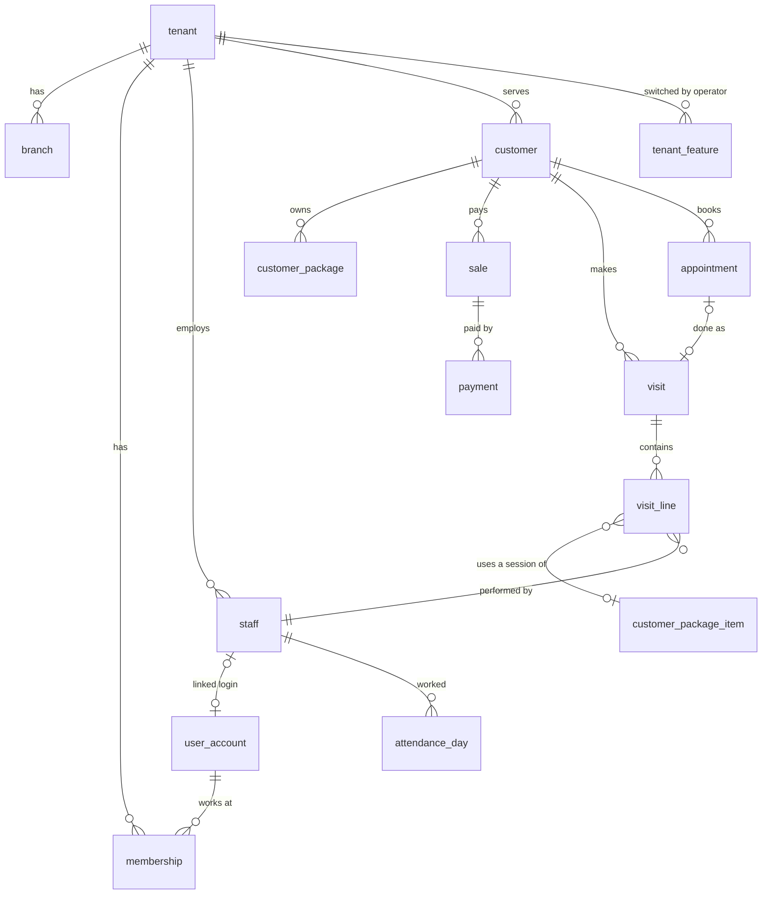
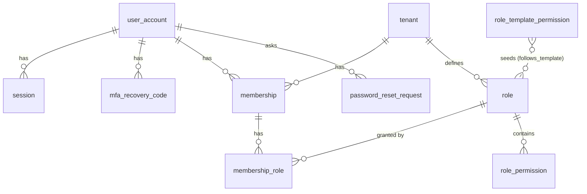
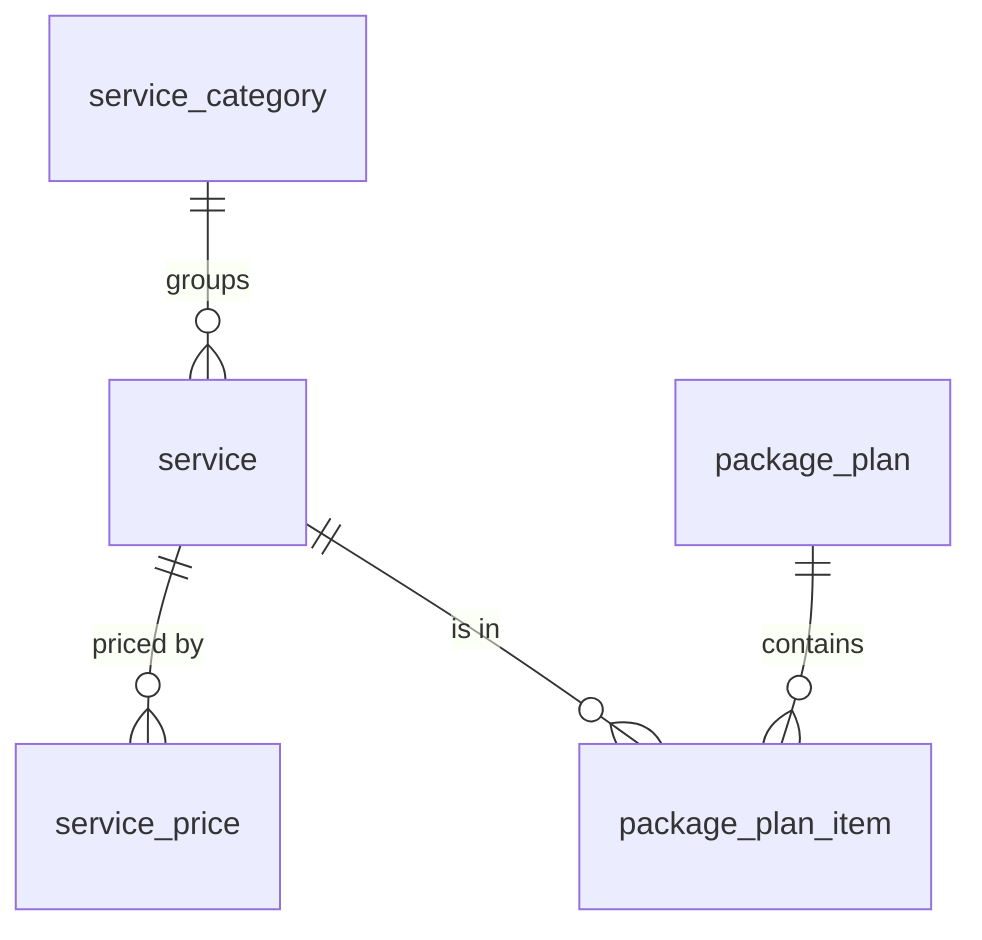
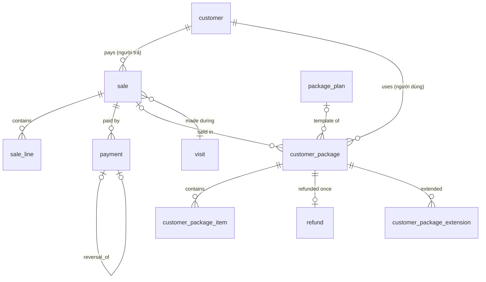
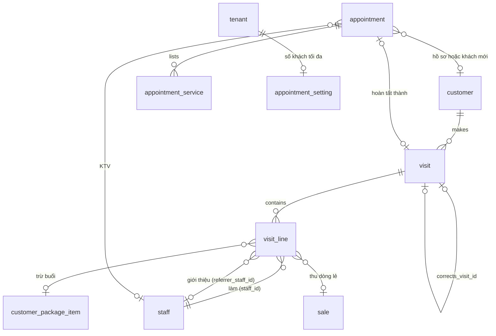
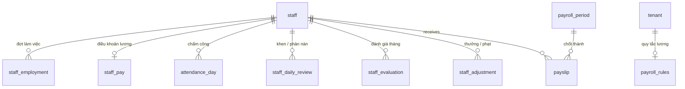
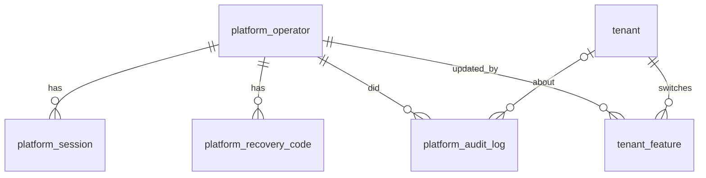

# Thiết kế cơ sở dữ liệu (database design)

Bản tổng quan cho người mới: bảng chia thành những nhóm nào, chúng nối với nhau ra sao, dữ liệu của các spa được tách thế nào và DB tự bảo vệ toàn vẹn bằng gì. Mọi tên bảng, cột và ràng buộc ở đây lấy từ migration trong [`apps/api/migrations/`](../apps/api/migrations) (0001–0044). Trang chi tiết từng bảng và lịch sử thay đổi theo vòng: [data](../memory/wiki/architecture/data.md). Kết quả đo và các cơ chế không được đổi: [db-review-2026-11](../memory/wiki/architecture/db-review-2026-11.md).

## 1. Quy ước chung

- **PostgreSQL (16 ở local/CI, 17 trên Supabase staging), một schema `app`.** 48 bảng, 2 view (`customer_package_state`, `revenue_book`), các hàm SQL ở mục 3. Extension: `pg_trgm`, `btree_gist`.
- **Khóa chính** `id uuid` dạng UUIDv7, do app sinh. Bảng thuộc spa có `tenant_id uuid NOT NULL` và `UNIQUE (tenant_id, id)`; **FK luôn kép** `(tenant_id, x_id) → x (tenant_id, id)`, nên ở mức DB không bản ghi nào trỏ được sang spa khác.
- **Tiền** là `bigint` đồng VND, không có số lẻ, có `CHECK` hình dạng (mục 4). **Thời điểm** là `timestamptz`. **Ngày nghiệp vụ** `business_date date` do server tính theo `tenant.timezone` (mặc định `Asia/Ho_Chi_Minh`), không bao giờ nhận từ client.
- **Bản chụp (snapshot)** tên dịch vụ, tên gói, giá bán, `per_session_value` được chép vào dòng hóa đơn / dòng lượt / gói của khách, để lịch sử và tiền không đổi khi bảng giá đổi.
- **Không xóa dữ liệu nghiệp vụ.** Khách bị ẩn danh (`anonymized_at`), nhân viên nghỉ việc (`status = 'left'` + đợt làm việc đóng), tài khoản bị khóa (`status = 'disabled'`), lượt / hóa đơn bị hủy (`voided`), gói bị hủy (`cancelled_at`). Sửa sai tiền bằng bút toán đảo.
- **Optimistic lock**: bảng sửa được có `version bigint`; API bắt `If-Match` và tăng `version` trong cùng câu `UPDATE`.
- **Văn bản**: chuẩn hóa NFC ở biên; `customer.search_text` = tên bỏ dấu, chữ thường, `đ→d` (app tính; `app.search_fold(text)` là bản SQL của cùng phép gập, có test so hai bản).
- Migration chỉ đi tới (`sqlx migrate`), đổi lớn theo **expand → backfill theo lô → kiểm tra → contract**.

## 2. Nhóm bảng

Tổng quan quan hệ giữa các nhóm (mỗi nhóm chi tiết ở dưới):



### 2.1 Kernel và tenancy

| Bảng | Vai trò | Điểm chính |
|---|---|---|
| `tenant` | Một spa | `slug` duy nhất, `timezone`, `status` (`active`/`suspended`), `settings jsonb` (ví dụ `manager_discount_max_pct`) |
| `branch` | Chi nhánh | `UNIQUE (tenant_id, name)`; R1 dùng một chi nhánh |
| `audit_log` | Ai đổi gì, lúc nào | `actor_kind` ∈ `user`/`platform_admin`/`system`, `before`/`after jsonb` (trường sức khỏe `"[redacted]"`), append-only (chỉ grant `SELECT, INSERT`), **giữ vĩnh viễn** |
| `idempotency_record` | Phát lại response của lệnh trùng | PK `(tenant_id, actor_user_id, key)`, `request_hash` 32 byte, dọn sau 48 giờ |
| `maintenance_run` | Ai đã chạy job bảo trì lúc nào | RLS bật, không policy, không grant: chỉ hàm `claim_maintenance` chạm được |

### 2.2 Identity và quyền



| Bảng | Phạm vi | Điểm chính |
|---|---|---|
| `user_account` | **Toàn cục** (một người có thể làm ở nhiều spa) | `phone_e164` duy nhất (`+84` + 9 số), `password_hash` bắt buộc dạng `$argon2id$`, `failed_logins`, `locked_until`, `mfa_secret_ct`, `mfa_enabled_at`, `mfa_last_step` (chống phát lại mã TOTP), `must_change_password` (0032) |
| `session` | Toàn cục | Chỉ lưu `token_hash` (SHA-256 của cookie), `active_tenant_id`, hạn idle / tuyệt đối (`CHECK idle ≤ absolute`), `recent_auth_at` **không có default** (quên truyền = lỗi, không phải cửa sổ re-auth miễn phí), `mfa_pending`, `revoked_at` |
| `mfa_recovery_code` | Toàn cục | Chỉ lưu hash, dùng một lần (`used_at`) |
| `membership` | Spa | Một người một membership mỗi spa, `status` `active`/`disabled` |
| `role`, `role_permission`, `membership_role` | Spa | Quyền là dữ liệu. Role hệ thống `owner`/`manager`/`technician` (`is_system`); `requires_mfa` (owner luôn true, có CHECK `role_owner_requires_mfa`); `follows_template` (0040) |
| `password_reset_request` | Spa | "Quên mật khẩu?": tối đa một yêu cầu mở mỗi người mỗi spa (unique một phần), hết hạn 24 giờ, `outcome` ∈ `reset`/`dismissed`/`expired` |
| `role_template_permission` | Toàn cục | Mẫu quyền của 3 role hệ thống cho spa mới (seed từ `SystemRole::default_permissions()`), chỉ operator sửa |

### 2.3 Catalog (bảng giá)



- `service_price.variant` ∈ `all`/`female`/`male`: hoặc một giá chung, hoặc giá theo Nữ/Nam; thiếu một giới tính = dịch vụ không áp dụng cho giới tính đó.
- `package_plan` (mẫu gói liệu trình): giá, `validity_months`, quà tặng; tên duy nhất trong các mẫu còn bán (unique một phần). `package_plan_item`: số buổi + buổi tặng **theo từng dịch vụ**, để gói combo không mơ hồ.

### 2.4 CRM (khách hàng)

- `customer`: `full_name` và `phone_e164` đều **tùy chọn** từ 0023 (hồ sơ không tên = "Khách vãng lai", hiển thị qua `app.customer_label`), SĐT có giá trị thì duy nhất trong hồ sơ còn hiệu lực (`customer_phone_uq … WHERE anonymized_at IS NULL`), `gender`, `birth_year` / `birth_date` (CHECK khớp nhau), `note`, `health_note_ct` (mã hóa), `anonymized_at`, `version`. Không có `DELETE` (ẩn danh thay cho xóa).
- `customer_follow_up` (chăm sóc lại khách vắng): kênh, kết quả, ngày hẹn gọi lại; **chỉ thêm** (trigger `reject_mutation`).

### 2.5 Bán hàng và gói liệu trình



| Bảng | Điểm chính |
|---|---|
| `sale` (hóa đơn) | `subtotal`, `discount_amount` + lý do, `total`, `amount_paid`, `status` `open`/`voided`, `closer_staff_id` (người chốt, có thể null = khách tự chọn), `visit_id` (hóa đơn làm trong lượt, FK `DEFERRABLE INITIALLY DEFERRED`), `source` (`app`/`paper_book`, chỉ cho audit), `note_ct` (ghi chú gói mã hóa) |
| `sale_line` | Bất biến; `line_type` `package`/`service`; `line_total = qty × unit_price`; `UNIQUE (tenant_id, sale_id, position)` |
| `payment` | Append-only. `kind` `payment`/`reversal`, `method` `cash`/`bank_transfer`, `amount > 0`; hủy hóa đơn = thêm dòng `reversal` trỏ `reversal_of` |
| `refund` | Hoàn tiền khi hủy gói, append-only, một lần mỗi gói, không vượt giá bán |
| `customer_package` | Gói của khách: `name_snapshot`, `sold_price`, `origin` (`sale`/`opening_balance` = sổ giấy cũ), `starts_on`, `expires_on`, hủy (`cancelled_at` + lý do + người). Người dùng gói có thể khác người trả (mua cho người khác) |
| `customer_package_item` | `sessions_purchased`, `sessions_bonus`, `sessions_total` (cột generated), `sessions_remaining` (`CHECK 0 ≤ remaining ≤ total`), `per_session_value` |
| `customer_package_extension` | Mỗi lần gia hạn một dòng (hạn cũ, hạn mới, lý do, người làm), chỉ thêm |

**Trạng thái gói được suy ra, không lưu**: `cancelled` (có `cancelled_at`) → `exhausted` (hết buổi) → `expired` (`expires_on` < hôm nay) → `active`. Định nghĩa SQL duy nhất là `app.package_status(…)` (IMMUTABLE), khớp `PackageStatus::derive` ở Rust; không cần job cập nhật trạng thái.

**Read model**: view `app.revenue_book` (sổ doanh thu: một dòng mỗi hóa đơn, một dòng âm mỗi lần hủy, một dòng âm mỗi lần hoàn) và `app.customer_package_state`, cả hai `WITH (security_invoker = true)` nên RLS của bảng gốc vẫn áp. Báo cáo và "Nhật ký ghi chú" đọc thẳng bảng gốc (UNION các nguồn tại chỗ, mỗi nhánh dưới quyền riêng), không chép dữ liệu.

**Công nợ** hoãn: R1 luôn thu đủ (`amount_paid = total`), cột và CHECK giữ sẵn để bật sau bằng view.

### 2.6 Vận hành: lượt khách và lịch hẹn



- `visit` (lượt khách): `business_date`, `check_in_at` (giờ làm, quyết định ngày nghiệp vụ; nhập bù dùng chính cột này), `note_ct` (ghi chú buổi mã hóa), `status` `completed`/`voided` + lý do / người / lúc, `sale_id` (hóa đơn dịch vụ lẻ đầu tiên), `corrects_visit_id` ("Sửa lượt": lượt mới trỏ lượt cũ, mỗi lượt bị thay tối đa một lần), `companions text[]` (người đi cùng dạng ghi chú). Không có giờ ra.
- `visit_line`: `source` `package` (cần gói + item + `sessions_left_after`) hoặc `one_off` (cần `price_variant`, `line_value = qty × unit_price − discount_amount`), một `CHECK` theo `source`. `line_value` là cơ sở tính hoa hồng.
- `appointment` (lịch hẹn): `customer_id` **hoặc** khách mới (`guest_name`, `guest_phone` tùy chọn khi ở trong nhóm), `starts_at`/`ends_at` (≤ 8 giờ), `staff_id`, `status` `booked → arrived → done` hoặc `no_show`/`cancelled` (bắt buộc `status_reason`), `visit_id` khi `done`, `group_id` (đặt nhóm / gia đình, không có bảng nhóm), `note`, `version`.
- `appointment_service`: tối đa 5 dịch vụ mỗi lịch (position 0–4). `appointment_setting.max_per_slot`: chỉ để cảnh báo.

### 2.7 Nhân sự, chấm công, lương



| Bảng | Điểm chính |
|---|---|
| `staff` | Hồ sơ: tên, SĐT, `position`, `user_id` (tài khoản gắn, duy nhất trong spa), `shift_start`, `note`; `status`/`joined_on`/`left_on` là **bản sao của đợt mới nhất** |
| `staff_employment` | Mỗi đợt làm việc một dòng; `EXCLUDE` không chồng đợt, tối đa một đợt mở; trigger chỉ đi tới; hồ sơ mới tự có đợt đầu (`staff_first_period`) ([ADR-0013](../memory/wiki/decisions/ADR-0013-employment-periods.md)) |
| `staff_pay` | Lương cơ bản, `commission_rate_bp`, thưởng gắn bó, tiền ăn; nhạy cảm, chỉ `payroll.read` |
| `payroll_rules` | `rules jsonb` của spa (thiếu key = mặc định trong code) |
| `attendance_day` | PK `(tenant_id, staff_id, work_date)`; `status` ∈ `present`/`leave_p`/`leave_dx`/`absent_k`, giờ đến/về, `late_minutes` (server tính) |
| `staff_daily_review`, `staff_evaluation` | Khen/phàn nàn theo ngày; đánh giá tháng (`criteria jsonb`, `total_points`, `result_level`, mức thấp bắt buộc `coaching_plan`) |
| `staff_adjustment` | Thưởng/phạt chỉ thêm; xóa = hủy mềm một lần (`voided_by`, 0024) |
| `payroll_period`, `payslip` | Kỳ lương `open → closed` (không mở lại, không xóa); phiếu lương là bản chụp `detail jsonb` + `net_pay`, chỉ thêm ([ADR-0008](../memory/wiki/decisions/ADR-0008-payroll-close-snapshots.md)) |

Trigger `reject_closed_period` trên `attendance_day`, `staff_daily_review`, `staff_evaluation`, `staff_adjustment`: tháng đã chốt thì không ghi, sửa, xóa được nữa.

### 2.8 Nền tảng (platform admin)



- `platform_operator`: principal riêng, **không phải** thành viên spa (username, Argon2id, TOTP luôn bắt buộc, khóa sau nhiều lần sai). `platform_session`: như `session` nhưng có `recent_auth_at` cho step-up 5 phút. `platform_audit_log`: append-only, `action` dạng `platform.*`, kèm `reason` (API bắt buộc lý do 3–500 ký tự cho mọi thao tác ghi).
- `tenant_feature (tenant_id, feature, enabled)`: không có dòng = tính năng bật. RLS theo spa, `app_rw` **chỉ đọc**; chỉ `app.platform_set_feature` ghi được.
- Chỉ crate `platform` có SQL chạm `app.platform_*` (test kiến trúc `platform_sql_stays_in_platform`). Chi tiết: [platform-admin](../memory/wiki/architecture/platform-admin.md), [ADR-0018](../memory/wiki/decisions/ADR-0018-platform-admin-console.md).

## 3. Mô hình RLS và quyền DB

**Hai role.** Schema owner chạy migration, `sqlx` compile-time check và test (`DATABASE_URL`). API chạy bằng **`app_rw`** (`APP_DATABASE_URL`): không phải owner bảng, không `BYPASSRLS`, được grant tối thiểu từng bảng (ví dụ `payment`, `refund`, `audit_log` chỉ `SELECT, INSERT`; không bảng nghiệp vụ nào có `DELETE`). `app_rw` là role cấp cluster, tạo ngoài migration (`infra/postgres-init/01-roles.sql` cho dev/CI, tạo tay một lần trên Supabase).

**Policy.** Mọi bảng thuộc spa có:
```sql
CREATE POLICY tenant_isolation ON app.<table>
  USING (tenant_id = app.current_tenant()) WITH CHECK (tenant_id = app.current_tenant());
```
`app.current_tenant()` đọc `current_setting('app.tenant_id', true)`; chưa đặt thì là `NULL` nên **không khớp dòng nào** (deny by default). `TenantTx` đặt giá trị bằng `set_config(…, true)`: chỉ sống trong transaction, không rò sang request sau trên cùng kết nối pool. Bảng `tenant` dùng policy `tenant_self` (`id = current_tenant()`). Câu query vẫn ghi `tenant_id = $1` tường minh: planner cần nó để dùng index tenant-first.

**Bảng không theo spa.** `user_account`, `session`, `mfa_recovery_code` là danh tính dùng chung, không RLS theo spa; chỉ crate `identity` chạm tới, luôn tra theo hash token hoặc SĐT. Bảng `platform_*` và `role_template_permission` bật RLS với policy `TO app_rw` (chặn các role khác như `anon` của Supabase); staging còn `REVOKE` quyền của `anon`/`authenticated` trên schema `app`.

**Hàm `SECURITY DEFINER`.** Có những việc bắt buộc phải nhìn qua nhiều spa hoặc chạy trước khi biết spa. Thay vì nới RLS hay cấp `BYPASSRLS`, mỗi việc là một hàm hẹp do owner định nghĩa. Hàm nào cũng có `SET search_path = app, pg_temp`, `REVOKE ALL … FROM PUBLIC`, `GRANT EXECUTE … TO app_rw`, chỉ chứa SQL tĩnh và trả đúng các cột đã liệt kê (có test so tên cột):

| Hàm | Vì sao cần | Trả về |
|---|---|---|
| `tenants_of_user(user)` | Đăng nhập xảy ra trước khi chọn spa | id + tên các spa active của người đó |
| `user_requires_mfa(user)` | Như trên; MFA không được tắt khi spa đang ngưng | bool |
| `session_actor(token_hash)` | Spa của request chỉ biết được từ dòng session ([ADR-0017](../memory/wiki/decisions/ADR-0017-one-statement-request-auth.md)) | session + cờ + quyền của spa đang chọn + cài đặt spa + `disabled_features` |
| `purge_idempotency_records(interval)`, `purge_sessions(interval)` | Dọn dẹp xuyên spa mà `app_rw` không có `DELETE` | số dòng xóa |
| `claim_maintenance(job, every)` | Một instance chạy job mỗi khoảng | bool |
| `invariant_violations()` | Kiểm bản sao dữ liệu trên mọi spa | tên phép kiểm + **số đếm** |
| `user_spa_suspended(user)` | Thông báo "spa đang tạm ngưng" sau khi mật khẩu đúng | bool |
| `platform_gate(token_hash, write)` (không grant) | Cổng chung của mọi hàm platform: hash phải là session operator còn sống, đã qua MFA; ghi thì cần step-up ≤ 5 phút | id operator hoặc lỗi `42501` |
| `platform_tenant_overview`, `platform_insert_tenant`, `platform_set_tenant_status`, `platform_set_feature`, `platform_apply_role_template`, `platform_account_memberships` | Console nền tảng; tham số đầu luôn là hash token operator, gọi `platform_gate` trước | số đếm / metadata, không dữ liệu khách |

Nếu một bug ở Rust gọi hàm platform từ route spa, hoặc quên kiểm operator, DB vẫn từ chối.

## 4. Toàn vẹn dữ liệu

Những cơ chế dưới đây trông như trùng với logic ở service, nhưng là lớp chặn cuối cùng. [db-review §6](../memory/wiki/architecture/db-review-2026-11.md) liệt kê chúng là **không được đổi**.

| Loại | Ví dụ cụ thể |
|---|---|
| CHECK tiền | `sale`: `total = subtotal − discount_amount AND total ≥ 0`, giảm giá phải có lý do, `amount_paid BETWEEN 0 AND total`; `sale_line.line_total = qty × unit_price`; `payment.amount > 0` và `(kind = 'reversal') = (reversal_of IS NOT NULL)`; `visit_line_check` theo `source` |
| Chỉ thêm (`app.reject_mutation`) | `payment`, `sale_line`, `refund`, `customer_follow_up`, `customer_package_extension`, `payslip`, `payroll_period` (chặn DELETE); `staff_adjustment` dùng trigger riêng `staff_adjustment_void_only` (0024: chỉ cho hủy mềm một lần); `audit_log` qua grant. Trigger chặn cả schema owner |
| Đảo / hoàn đúng một lần | `payment_reversal_mirrors_original` (cùng hóa đơn, hình thức, số tiền) + `UNIQUE (tenant_id, reversal_of)`; `refund` `UNIQUE (tenant_id, customer_package_id)` + `refund_within_paid` (≤ giá bán) |
| Trạng thái chỉ đi tới | `visit_voided_is_final`, `sale_voided_is_final`, `customer_package_cancelled_is_final`, `customer_package_item_no_restore_when_cancelled`, `appointment_closed_is_final`, `payroll_period_forward_only` (+ không DELETE), `staff_employment_forward_only` |
| Liên kết bất biến | `visit_correction_link` (lượt bị thay phải đã hủy, cùng ngày), `sale_visit_link` (gắn một lần, cùng khách), `customer_package_sale_link` (gói sổ giấy gắn một lần vào hóa đơn sổ giấy của cùng khách) |
| `EXCLUDE USING gist` | Lịch hẹn: cùng KTV không chồng giờ khi `status IN ('booked','arrived')` (thêm khóa advisory theo (spa, ngày) ở service); đợt làm việc của một người không chồng nhau |
| Unique một phần | Một SĐT một hồ sơ còn hiệu lực, một tên mẫu gói đang bán, một tài khoản gắn một hồ sơ, một đợt làm việc mở, một yêu cầu quên mật khẩu đang mở |
| FK | Kép theo tenant ở mọi nơi; cột "người làm" (`created_by`, `voided_by`, `cancelled_by`, `closed_by` của lượt, hóa đơn, thanh toán, hoàn tiền, gói, lịch hẹn) → `user_account` (0036 `NOT VALID`, 0037 `VALIDATE`) |
| Khóa và đồng thời | READ COMMITTED + khóa tường minh: thứ tự lượt/hóa đơn → gói → item theo id, `FOR SHARE` gói trước khi trừ buổi, `UPDATE … WHERE sessions_remaining >= qty` (0 dòng → `409`), `FOR SHARE` kỳ lương khi ghi dữ liệu HR |
| Optimistic lock | `version` + `If-Match` → `412 conflict.stale_version` (máy quầy và điện thoại KTV cùng sửa) |
| Idempotency | `idempotency_record` claim + complete trong cùng transaction với use case, hash request (cùng key khác thân → `422 idempotency.key_reuse_mismatch`), giữ 48 giờ |
| Tháng lương đã chốt | `reject_closed_period` trên 4 bảng HR |
| Kiểm định kỳ | `app.invariant_violations()` mỗi ngày (11 phép kiểm, xem [system-design §5](system-design.md#5-bảo-trì-nền-background-maintenance)) |

## 5. Mã hóa và băm

| Dữ liệu | Cách lưu |
|---|---|
| `customer.health_note_ct`, `visit.note_ct`, `sale.note_ct` | AES-256-GCM ở tầng app (`kernel::crypto`). Ciphertext = tiền tố phiên bản key + nonce 12 byte + ciphertext. **AAD gắn với bản ghi** (tenant + khách, tenant + lượt, `sale.note` + tenant + hóa đơn), nên chép ciphertext sang bản ghi khác thì không giải mã được. Không có bản rõ trong DB, audit hay bảng idempotency |
| `user_account.mfa_secret_ct`, `platform_operator.mfa_secret_ct` | AES-256-GCM, AAD gắn id tài khoản |
| Key | `APP_DATA_KEY` (32 byte base64) chỉ ở env / secret store, không bao giờ ở DB. Mất key = mất ghi chú sức khỏe và secret MFA, nên phải backup key. Xoay key: ciphertext đã mang byte `v` + số phiên bản key nên làm được về sau, hiện chỉ có một key, chưa làm |
| Mật khẩu | Argon2id (`CHECK password_hash LIKE '$argon2id$%'`) |
| Token session, mã khôi phục MFA | Chỉ lưu SHA-256 (32 byte) |

Hệ quả: không tìm được trong ghi chú mã hóa bằng SQL; "Nhật ký ghi chú" giải mã ở Rust và giới hạn quét ≤ 500 dòng mỗi request.

## 6. Index và kết quả rà soát 2026-11

**Triết lý.** Index nào cũng dẫn đầu bằng `tenant_id` rồi tới cột lọc thật (`business_date`, `customer_id`, `staff_id`…). Ưu tiên index một phần cho các nhánh thưa (chỉ dòng có ghi chú, chỉ bản ghi đã hủy, chỉ nhân viên đang làm). Chỉ thêm index khi có câu query dùng nó và đã đo bằng `EXPLAIN (ANALYZE)` trên dữ liệu 3 năm; bỏ index không được dùng.

**Rà soát 2026-11** ([db-review-2026-11](../memory/wiki/architecture/db-review-2026-11.md), EM duyệt hết 2026-11-09):
- Toàn vẹn rất chắc: 11 phép kiểm bất biến trên staging đều 0 dòng lệch; không đề xuất nào nới lỏng.
- 3 năm dữ liệu của một spa đông ≈ **312 MB** (audit chiếm 40 %); 29/40 câu nóng ≤ 3 ms. Nút thắt là số lượt đi về API ↔ DB, không phải thời gian chạy query.
- **A1** pool chỉ ping khi kết nối rảnh > 30 s; **A2** lịch sử khách viết lại bằng `UNION` (79–94 ms → < 1 ms ở 3 năm); **A3** `app.session_actor` (0034, −3 lượt đi về mỗi request); **A4** cài đặt spa đi theo `Actor`.
- **B1** (0033) bỏ 8 index: 2 GIN trigram trên `customer` (dưới RLS `LIKE` không leakproof nên Postgres không bao giờ dùng được; tìm khách quét theo `tenant_id`, 1–1,5 ms ở 8 000 khách), 2 index trùng tiền tố của unique `(tenant_id, x_id, position)`, 4 index ngày dẫn đầu `branch_id`. −16 MB ở 3 năm, plan không đổi; DDL hoàn tác ghi trong file migration.
- **C1/C2** (0035) dọn session 30 ngày + kiểm bất biến hằng ngày; **C4** (0036/0037) FK cột "người làm" + `idle_in_transaction_session_timeout = 30s`. **C3** index `membership (user_id)` để tới khi có spa thứ hai.
- Theo dõi, chưa sửa: seq scan `visit_line` theo tháng, plan sổ doanh thu, "Khách lâu chưa quay lại" (64–68 ms). Đo lại bằng `infra/perf/db/` khi dữ liệu gấp 3 lần hoặc mỗi năm.

## 7. Migration theo dải số

| Dải | Nội dung |
|---|---|
| 0001–0007 | Nền R1-1: schema `app`, `current_tenant()`, tenant/branch/audit/idempotency (0001); identity + role là dữ liệu (0002); catalog (0003); khách hàng (0004); nhân viên tối thiểu, hóa đơn, thanh toán append-only, gói của khách (0005); MFA TOTP (0006); lượt khách (0007) |
| 0009–0012 | Hủy và vòng đời gói: bút toán đảo, hoàn tiền, trạng thái chỉ đi tới (0009); hardening sau security review (0011); đơn giản hóa nhập sổ giấy theo quyết định EM (0012) |
| 0013–0015 | Màn quản lý R1-2: `package_status`, view `revenue_book` + `customer_package_state`, quyền báo cáo, index ngày (0013); chăm sóc lại khách vắng + `search_fold` (0014); báo cáo dài hạn cho chủ spa (0015) |
| 0016–0022 | Lịch hẹn + `EXCLUDE` + giảm giá dòng lượt + nhập bù (0016); quản lý nhân viên, chấm công, đánh giá, lương, chốt tháng (0017); tiền sổ giấy là hóa đơn (0018); lịch dạng dòng thời gian, đặt nhóm, số khách tối đa (0019); "Sửa lượt" (0020); upsell trong lượt, giỏ bán gói, người đi cùng (0021); người đi cùng được làm (0022) |
| 0023–0030 | Danh tính khách: không tên, SĐT tùy chọn, ngày sinh, sổ gia hạn (0023); hủy mềm thưởng/phạt (0024); đợt làm việc (0025); người đã nghỉ vẫn đăng nhập xem quá khứ (0026); index cho "Nhật ký ghi chú" (0027–0029); ghi chú gói mã hóa (0030) |
| 0032 | Tài khoản từ hồ sơ nhân viên, mật khẩu tạm, yêu cầu quên mật khẩu ([ADR-0016](../memory/wiki/decisions/ADR-0016-accounts-and-passwords.md)) |
| 0033–0037 | Rà soát DB 2026-11: bỏ 8 index (0033), `session_actor` (0034), dọn session + kiểm bất biến + `maintenance_run` (0035), FK cột người làm (0036, 0037) |
| 0038–0040 | Console nền tảng: operator, session, audit, hàm cổng (0038); cờ tính năng theo spa (0039); mẫu vai trò + tài khoản xuyên spa (0040) |
| 0041–0044 | Rà soát toàn bộ 2026-11-09: mọi thao tác ghi của console (tài khoản, vai trò của một spa) qua hàm DB kiểm step-up, chặn khóa chủ spa cuối dưới advisory lock, dọn `platform_session`, bỏ nhánh `platform.tenant.manage` chết trong `user_requires_mfa` (0041); gia cố schema: `user_in_other_spa` chặn reset mật khẩu khi có membership ở spa khác, sàn cho hàm dọn (48 h idempotency, 1 ngày session), thu hẹp quyền `app_rw` trên `role`/`membership`/`branch`, FK: item của một dòng lượt phải thuộc đúng gói của dòng đó, và FK `appointment_setting.updated_by` (0042, VALIDATE ở 0043); `purge_sessions` dọn cả hai loại session (0044, sửa 0042 ghi đè 0041) |

Số 0008, 0010, 0031 bỏ trống (được giữ chỗ rồi không dùng). Migration nhúng vào binary qua `kernel/build.rs` (`rerun-if-changed`), chạy bằng `pnpm db:migrate`. Sửa query thì chạy `pnpm db:prepare` và commit `apps/api/.sqlx` (CI build ở chế độ offline).
