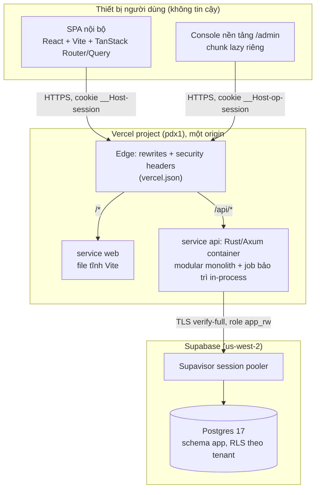
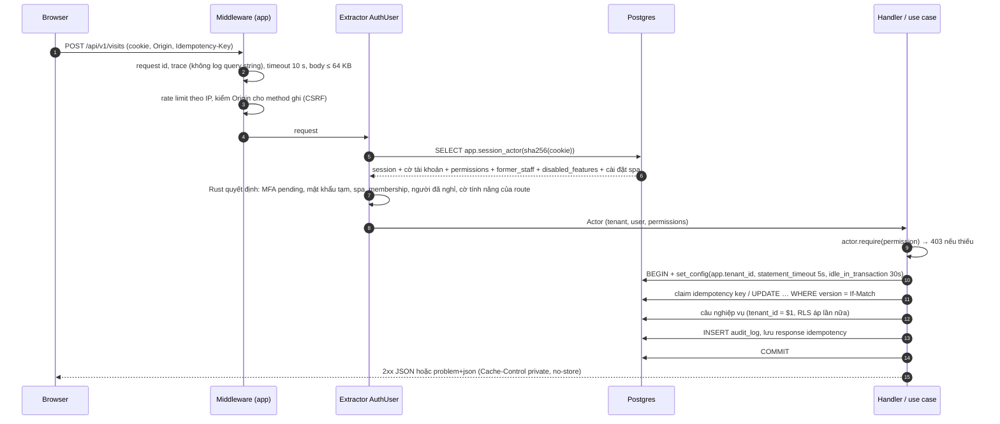
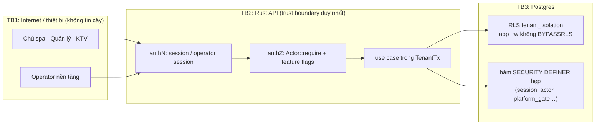
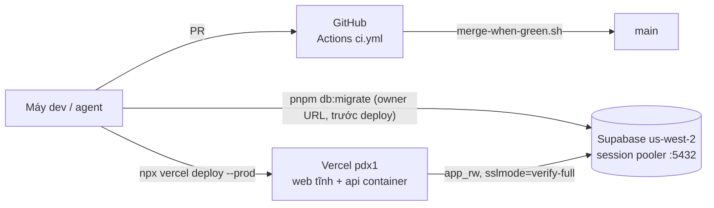

# Thiết kế hệ thống (system design)

Trang này là bản tổng quan cho người mới: hệ thống gồm những gì, một request đi qua đâu, ranh giới tin cậy nằm ở đâu, chạy trên hạ tầng nào và được giữ nhanh ra sao. Chi tiết và lý do của từng quyết định nằm trong wiki [`memory/wiki/`](../memory/index.md); mỗi mục dưới đây có link tới trang gốc. Khi hai nơi lệch nhau, **code và wiki là nguồn đúng**, trang này cần sửa theo.

Thứ tự ưu tiên chất lượng quyết định mọi đánh đổi ([system §1](../memory/wiki/architecture/system.md)):
1. bảo mật và toàn vẹn dữ liệu (tiền, số buổi đã trả, dữ liệu sức khỏe);
2. dễ thay đổi (quy chế lương, quyền, gói dịch vụ đổi liên tục);
3. tốc độ thao tác ở quầy (mục tiêu < 30 giây một lượt khách);
4. chi phí thấp;
5. sẵn sàng trong giờ mở cửa;
6. mở rộng (tải rất thấp, khoảng 40 lượt/ngày/spa; chỉ cần không chặn đường lên nhiều spa).

## 1. Thành phần

- **Một origin duy nhất.** Vercel rewrite `/api/*` sang service `api`, phần còn lại sang `web` ([`vercel.json`](../vercel.json)). Không có CORS; cookie `SameSite=Strict` và CSP `'self'` hoạt động tự nhiên ([ADR-0005, update 2026-11-05](../memory/wiki/decisions/ADR-0005-compute-hosting.md)).
- **Rust API là trust boundary duy nhất** cho authN, authZ, tách tenant và mọi phép tính tiền. SPA chỉ hiển thị; mọi guard ở frontend chỉ là UX.
- **Không Redis, không queue ngoài.** Session lưu ở Postgres, rate limit in-memory theo instance, job chạy trong process ([ADR-0001](../memory/wiki/decisions/ADR-0001-tech-stack.md)).
- **Contract-first.** `apps/api/openapi.json` sinh từ code (utoipa), `packages/api-client` sinh type TypeScript từ đó (`pnpm api:gen`). Backend đổi field thì frontend lỗi type ngay khi build ([principles #8](../memory/wiki/architecture/principles.md)).

### Bounded context (crate) trong `apps/api/crates/`
Mỗi context là một crate, chỉ export public API; không crate nào đọc bảng của crate khác ([ADR-0006](../memory/wiki/decisions/ADR-0006-repo-and-module-layout.md)).

| Crate | Trách nhiệm |
|---|---|
| `kernel` | Nền dùng chung: `TenantId`, `Money`, `BusinessDate`, `AppError` (problem+json), `Permission` + `Actor::require`, `TenantTx`, idempotency, audit, mã hóa field (`crypto`), registry cờ tính năng (`feature`), migrator nhúng |
| `identity` | Tài khoản, mật khẩu (Argon2id), session, MFA TOTP, khóa tài khoản, role/permission, `/auth/*`, `/me`, đổi/đặt lại mật khẩu |
| `org` | Hồ sơ nhân viên, đợt làm việc, gắn tài khoản, nghỉ việc / nhận lại |
| `catalog` | Nhóm dịch vụ, dịch vụ, bảng giá Nữ/Nam, mẫu gói liệu trình |
| `crm` | Khách hàng, tìm không dấu, ghi chú sức khỏe mã hóa, chăm sóc lại khách vắng |
| `packages` | Gói liệu trình của khách: số buổi, hạn, gia hạn, hủy + hoàn tiền |
| `sales` | Hóa đơn, thanh toán append-only, bút toán đảo, giỏ bán gói (checkout), ghi chú gói |
| `operations` | Lượt khách (ghi, sửa, hủy, chuyển sang gói, thêm dịch vụ), lịch hẹn |
| `hr` | Chấm công, khen/phàn nàn, đánh giá tháng, thưởng/phạt, bảng lương + chốt tháng, `/me/staff/*` |
| `reporting` | Tổng quan hôm nay, báo cáo theo kỳ, sổ doanh thu, lịch sử khách, gói của khách, nhật ký ghi chú |
| `platform` | Console nền tảng: operator, spa, cờ tính năng, mẫu vai trò, tài khoản xuyên spa, nhật ký nền tảng ([platform-admin](../memory/wiki/architecture/platform-admin.md)) |
| `app` | Binary: router, middleware, config, job bảo trì, CLI (`migrate`, `create-tenant`, `add-user`, `seed-demo`, `reset-demo`, `add-operator`…) |

Chi tiết API (endpoint, lỗi, idempotency, ETag): [backend](../memory/wiki/architecture/backend.md). Frontend (route, data fetching, PWA, cấu trúc thư mục): [frontend](../memory/wiki/architecture/frontend.md).

## 2. Vòng đời một request

Các bước theo thứ tự:
1. **Middleware chung** ([`app/src/middleware.rs`](../apps/api/crates/app/src/middleware.rs)): `x-request-id`, trace chỉ ghi method + path (query string có tên và SĐT khách nên không bao giờ vào log), `Server-Timing`, timeout 10 s (`408`), body tối đa 64 KB (`413`), rate limit theo IP (5 request/s, burst 60; `/auth/*` 1 request/3 s burst 10; `/admin/auth/*` 1 request/6 s burst 5), **kiểm `Origin`** cho mọi method ghi (chỉ `APP_PUBLIC_ORIGIN`, và `APP_ADMIN_ORIGIN` cho `/api/v1/admin/*` khi console có host riêng). Response mặc định `Cache-Control: private, no-store`.
2. **Xác thực một câu SQL** ([ADR-0017](../memory/wiki/decisions/ADR-0017-one-statement-request-auth.md)): cookie `__Host-session` → SHA-256 → `app.session_actor(token_hash)` trả session còn sống, cờ tài khoản (MFA, `must_change_password`), quyền của membership đang chọn, cờ người đã nghỉ, cờ tính năng đang tắt và cài đặt spa. Hàm chỉ đọc; **quyết định vẫn ở Rust**: session MFA pending chỉ dùng được cho `/auth/mfa/*`, mật khẩu tạm chỉ được đổi mật khẩu, người đã nghỉ chỉ còn `staff.read_own_past` ([ADR-0014](../memory/wiki/decisions/ADR-0014-former-staff-login.md)), tính năng tắt thì rút permission và route trả `403 feature.disabled` ([ADR-0018 D4](../memory/wiki/decisions/ADR-0018-platform-admin-console.md)).
3. **Phân quyền**: code chỉ hỏi `actor.require(Permission::X)`; quyền là dữ liệu (`role_permission`), không có `if role == …` ([principles #2](../memory/wiki/architecture/principles.md)). Thứ tự lỗi: `401` → `403` → `404` → `422` → `409`; quyền được kiểm **trước** khi đọc query/body (`authorized_then`, [authz-matrix](../memory/wiki/security/authz-matrix.md)). Tài nguyên của spa khác trả `404`, không phải `403`.
4. **Transaction của tenant** (`kernel::TenantTx`, [`db.rs`](../apps/api/crates/kernel/src/db.rs)): mỗi use case chạy trong đúng một transaction; `BEGIN` cùng `set_config('app.tenant_id', …, true)`, `statement_timeout = 5s`, `idle_in_transaction_session_timeout = 30s` trong **một** lượt đi về. Setting là transaction-local nên không rò sang request sau trên cùng kết nối pool. Không gọi mạng khi transaction đang mở.
5. **Chống ghi đôi, chống lost update**: lệnh tạo tiền hoặc trừ buổi bắt buộc `Idempotency-Key: <uuid>`; key được claim và hoàn tất **trong cùng transaction** với use case, request trùng chờ khóa PK rồi phát lại response cũ (giữ 48 giờ). Sửa bản ghi có phiên bản bắt buộc `If-Match: "<version>"`; lệch phiên bản → `412 conflict.stale_version` ([backend](../memory/wiki/architecture/backend.md)).
6. **Truy vấn**: mọi câu có `tenant_id = $1` tường minh (để planner dùng index tenant-first), RLS là lớp thứ hai khi code quên ([ADR-0003](../memory/wiki/decisions/ADR-0003-multi-tenancy.md)).
7. **Audit**: mọi thay đổi ghi `audit_log` (append-only, trường sức khỏe ghi `"[redacted]"`) trong cùng transaction; thao tác của operator còn ghi `platform_audit_log`.
8. **Lỗi**: `application/problem+json` với `code` ổn định (`auth.mfa_required`, `feature.disabled`, `appointment.customer_busy`…); frontend map `code` sang thông báo tiếng Việt.

## 3. Ranh giới tin cậy và mô hình bảo mật

Bảng STRIDE đầy đủ cho từng boundary: [threat-model](../memory/wiki/security/threat-model.md). Ma trận permission × role và test bắt buộc: [authz-matrix](../memory/wiki/security/authz-matrix.md).

| Lớp | Cơ chế | Nguồn |
|---|---|---|
| Phân quyền | Chỉ ở server. Identity lấy từ session, không bao giờ từ body/query/header client gửi (`userId`, `role`, giá). Response chỉ chứa dữ liệu người gọi được xem: ghi chú sức khỏe chỉ có khi có `customer.health_notes.read`, số tiền chỉ có khi có `report.revenue.read`. Test `authz_matrix.rs` phủ mọi route × mọi role | [authz-matrix](../memory/wiki/security/authz-matrix.md) |
| Tách spa | Shared schema + `tenant_id` + RLS; FK kép `(tenant_id, x_id)`; role runtime `app_rw` không phải owner bảng, không `BYPASSRLS` | [ADR-0003](../memory/wiki/decisions/ADR-0003-multi-tenancy.md), [database-design §3](database-design.md#3-mô-hình-rls-và-quyền-db) |
| Đi qua tenant có kiểm soát | Việc bắt buộc phải xuyên tenant (liệt kê spa khi đăng nhập, xác thực request, dọn dẹp, console) đi qua hàm `SECURITY DEFINER` hẹp: `search_path` ghim, SQL tĩnh, chỉ `app_rw` được `EXECUTE`, trả đúng các cột đã liệt kê | [ADR-0017](../memory/wiki/decisions/ADR-0017-one-statement-request-auth.md), [ADR-0018](../memory/wiki/decisions/ADR-0018-platform-admin-console.md) |
| Đăng nhập spa | SĐT + mật khẩu Argon2id; session opaque (DB chỉ giữ SHA-256 của token), cookie `__Host-session` (Secure, HttpOnly, SameSite=Strict); idle 12 giờ, tối đa 30 ngày; khóa tài khoản sau nhiều lần sai + rate limit IP | [ADR-0004](../memory/wiki/decisions/ADR-0004-authentication.md) |
| MFA | TOTP bắt buộc cho role có `requires_mfa` (role `owner` luôn bật, có CHECK) ở spa có công tắc `owner_mfa_required` bật (mặc định; operator tắt được theo spa, [ADR-0020](../memory/wiki/decisions/ADR-0020-owner-mfa-per-spa.md)); đăng nhập hỏi mã khi và chỉ khi `user_requires_mfa`; mã khôi phục dùng một lần (chỉ lưu hash); đăng nhập hai bước với session pending 10 phút rồi xoay token | [ADR-0004](../memory/wiki/decisions/ADR-0004-authentication.md) |
| Mật khẩu tạm | Chủ spa tạo tài khoản / đặt lại mật khẩu → mật khẩu tạm hiện một lần, `must_change_password` khóa mọi route trừ đổi mật khẩu; "Quên mật khẩu?" gửi yêu cầu cho chủ spa (không email/SMS) | [ADR-0016](../memory/wiki/decisions/ADR-0016-accounts-and-passwords.md) |
| Re-auth | Thao tác bảo mật tài khoản cần xác thực lại trong 5 phút (mật khẩu, thêm mã nếu MFA đang bắt buộc) | [ADR-0004](../memory/wiki/decisions/ADR-0004-authentication.md) |
| Operator nền tảng | Principal riêng (bảng `platform_operator`, `platform_session`, cookie `__Host-op-session`), TOTP luôn bắt buộc, idle 30 phút / tối đa 8 giờ, **step-up ≤ 5 phút cho mọi request ghi** (kiểm ở Rust và lại ở DB bằng `app.platform_gate`), không bypass RLS, audit hai phía | [ADR-0018](../memory/wiki/decisions/ADR-0018-platform-admin-console.md) |
| Mã hóa field | AES-256-GCM tầng app cho ghi chú sức khỏe, ghi chú buổi, ghi chú gói và secret MFA; key `APP_DATA_KEY` chỉ nằm trong env, AAD gắn với bản ghi | [database-design §5](database-design.md#5-mã-hóa-và-băm) |
| CSRF / trình duyệt | Kiểm `Origin` cho method ghi + SameSite=Strict + một origin; header từ `vercel.json`: HSTS, CSP `default-src 'self'`, `frame-ancestors 'none'`, COOP/CORP, `X-Frame-Options: DENY`, `nosniff` | [threat-model](../memory/wiki/security/threat-model.md) |
| Bí mật | Không bao giờ trong bundle client hay git; `.env` bị gitignore, Vercel env dạng sensitive, đặt bằng stdin; gitleaks chạy ở CI | [vercel-staging](../memory/wiki/runbooks/vercel-staging.md) |
| Tính năng theo spa | Operator tắt một tính năng → permission bị rút khỏi mọi thành viên spa, route trả `403 feature.disabled` trước khi handler chạy; `app_rw` chỉ đọc bảng cờ nên spa không tự bật lại được | [ADR-0018 D4](../memory/wiki/decisions/ADR-0018-platform-admin-console.md) |

## 4. Triển khai (deployment topology)

| Môi trường | Ở đâu | Ghi chú |
|---|---|---|
| Local dev | Postgres 16 trong Docker (CI cũng 16; Supabase staging chạy 17) (`infra/docker-compose.dev.yml`), API `127.0.0.1:8080`, Vite `localhost:5173` proxy `/api` | Xem [README](../README.md#chạy-local) |
| Staging (đang chạy) | Vercel project, region **`pdx1`**; Supabase **`us-west-2`** qua Supavisor **session mode** (prepared statements của sqlx cần session mode) | `APP_DB_MAX_CONNECTIONS=3` mỗi instance; instance scale về 0 khi rảnh nên có cold start. Runbook: [vercel-staging](../memory/wiki/runbooks/vercel-staging.md). Staging ở Mỹ vì EM test từ Mỹ ([ADR-0012 update](../memory/wiki/decisions/ADR-0012-colocate-api-db-singapore.md)) |
| Production (kế hoạch) | API + DB cùng Singapore (Supabase `ap-southeast-1`; API trên Vercel `sin1`, Fly.io `sin` luôn chạy, hoặc VPS — chưa chọn) | [ADR-0012](../memory/wiki/decisions/ADR-0012-colocate-api-db-singapore.md) (proposed), [ADR-0002](../memory/wiki/decisions/ADR-0002-database-hosting.md). Trước khi dùng thật: Supabase Pro (backup), Vercel Pro |
| Đường VPS dự phòng | Docker Compose + Caddy (`infra/docker-compose.prod.yml`, `infra/Caddyfile`, `.github/workflows/deploy.yml` chạy tay) | Thiết kế gốc của [ADR-0005](../memory/wiki/decisions/ADR-0005-compute-hosting.md), runbook [staging-setup](../memory/wiki/runbooks/staging-setup.md) (đã đánh dấu superseded cho staging); hiện không có VPS nào chạy |

**CI và merge.** `.github/workflows/ci.yml` phân loại file thay đổi rồi chạy job tương ứng: Rust fmt/clippy, test Rust chia shard (nextest), build API + kiểm contract OpenAPI, web lint/typecheck/test, E2E Playwright chia theo thời gian, perf (API p95 + Lighthouse), images, gitleaks; job `CI ok` gom kết quả. Nhánh `main` chưa bật branch protection, nên **`scripts/merge-when-green.sh <pr>` là cổng merge** (chỉ merge khi `CI ok` xanh). Khi GitHub Actions không chạy được thì dùng `scripts/merge-local-gate.sh` ([local-merge-gate](../memory/wiki/runbooks/local-merge-gate.md)). Chi tiết job graph: [testing](../memory/wiki/conventions/testing.md).

**Migration** chạy bằng role owner (`DATABASE_URL`, `pnpm db:migrate`) **trước** khi deploy code mới; runtime không bao giờ kết nối bằng owner.

## 5. Bảo trì nền (background maintenance)

Không có cron ngoài. `app::jobs::spawn_maintenance` ([`jobs.rs`](../apps/api/crates/app/src/jobs.rs)) thức dậy lúc instance khởi động rồi mỗi giờ. Trên host scale-to-zero có thể có nhiều instance cùng lúc, nên mỗi job phải **claim** trước: `app.claim_maintenance(job, every)` là một upsert nguyên tử trên `app.maintenance_run`, chỉ một instance thắng trong mỗi khoảng (trước đây staging chạy purge 217 lần trong 10 ngày, [db-review F10](../memory/wiki/architecture/db-review-2026-11.md)).

| Job | Chu kỳ claim | Việc |
|---|---|---|
| `purge` | 55 phút | `app.purge_idempotency_records('48 hours')`; `app.purge_sessions('30 days')`: xóa session đã thu hồi / hết hạn quá 30 ngày (tối thiểu hóa IP + user agent, EM Q-DB4) |
| `invariants` | 23 giờ | `app.invariant_violations()`: 11 phép kiểm bản sao dữ liệu trên mọi spa, **chỉ trả số đếm** (không dữ liệu khách). Có dòng lệch → log `ERROR data invariant violated` để hosting log alert |

11 phép kiểm: `sale_amount_paid`, `payment_branch`, `visit_sale_link`, `voided_visit_open_sale`, `sessions_remaining`, `cancelled_package_sessions`, `package_sale_copy`, `staff_mirrors_employment`, `customer_search_text`, `business_date_local_day`, `appointment_visit_customer` (định nghĩa ở migration 0035, bản chạy tay `infra/perf/db/invariants.sql`). Cả bốn hàm (`claim_maintenance`, `purge_idempotency_records`, `purge_sessions`, `invariant_violations`) là `SECURITY DEFINER`, nên `app_rw` không cần quyền `DELETE` trên `session` hay `BYPASSRLS`. `audit_log` **không có hạn giữ** (EM Q-DB4).

## 6. Hiệu năng (performance budgets)

| Ngân sách | Giá trị | Kiểm bằng |
|---|---|---|
| JS khởi động (entry + modulepreload, gzip -9) | ≤ 125 KiB (hiện 124,88 KiB, 2026-11-11) | Gate CI `pnpm --filter web budget` sau `vite build`, ghi trong [frontend § Perf budget](../memory/wiki/architecture/frontend.md) |
| LCP mobile (Slow 4G, CPU 4×) `/dang-nhap`, `/quay` | ≤ 2,5 s (trung vị 5 lần) | Lighthouse CI chặn merge ([`lighthouserc.json`](../apps/web/lighthouserc.json)) |
| CLS / accessibility | ≤ 0,1 / ≥ 0,95 | Lighthouse CI |
| API p95 tìm khách + catalog | < 300 ms | `apps/web/e2e/perf/api-latency.spec.ts` |
| Báo cáo trên 3 năm dữ liệu | p95 ≤ 300 ms; báo cáo 3–5 năm của chủ spa ≤ 1,5 s | `app/tests/reports_bench.rs` (`--ignored`) |
| Một câu SQL / một request | `statement_timeout` 5 s; request timeout 10 s | `TenantTx`, middleware |
| Thao tác quầy | < 30 giây một lượt, ≤ 4 thao tác cho đường nhanh | [front-desk-flows](../memory/wiki/design/front-desk-flows.md) |

Điều đã đo được: Postgres không phải nút thắt (29/40 câu nóng ≤ 3 ms trên 3 năm dữ liệu). Thời gian chủ yếu nằm ở **mạng VN ↔ Oregon** (> 80 % mỗi request) và **số lượt đi về API ↔ DB**. Vì vậy các tối ưu tập trung vào bớt lượt đi về: pool chỉ ping khi kết nối rảnh > 30 s, `BEGIN` + setting một lượt, xác thực một câu (`session_actor`), cài đặt spa mang theo trong `Actor`. Phía web: chunk lazy cho mọi màn ngoài màn đầu, preload theo intent, `staleTime` 30 s, ghi thẳng response vào cache. Xem [performance-latency-2026-11](../memory/wiki/architecture/performance-latency-2026-11.md) và [db-review-2026-11](../memory/wiki/architecture/db-review-2026-11.md).

## 7. Frontend tóm tắt

- `apps/web`: SPA React + Vite, **TanStack Router** (route + loader + trạng thái danh sách trên URL, [ADR-0007](../memory/wiki/decisions/ADR-0007-navigation-and-url-state.md)) và **TanStack Query** (cache server state, invalidation theo query key). Form khách hàng, dịch vụ và mẫu gói dùng react-hook-form + zod; các form khác dùng state thường + `useFormAction`. Lỗi `422` map vào field theo `errors[].field` (`ApiError.fieldCode`).
- Điều hướng một mô hình (`app/nav.ts`) cấp cho sidebar, drawer điện thoại, tab bar và command palette, lọc theo permission của `/me` (chỉ là UX).
- Console nền tảng `/admin` là **ứng dụng con riêng** trong `src/admin/`: `main.tsx` chỉ `import("./admin/boot")` khi pathname bắt đầu bằng `/admin`, nên bundle của spa không đổi. Console có `QueryClient` riêng và điều hướng đơn giản bằng History API (không dùng router thứ hai).
- Design system "Trà thất Đông y": token màu/chữ/khoảng cách, component class dùng chung (`packages/ui`, `components.css`), test chặn màu ngoài token ([design-system](../memory/wiki/design/design-system.md)).

## 8. Đọc thêm

| Chủ đề | Trang |
|---|---|
| Kiến trúc gốc R1 (C4, failure modes, chi phí) | [system](../memory/wiki/architecture/system.md) |
| Nguyên tắc mở rộng | [principles](../memory/wiki/architecture/principles.md) |
| API contract, use case, integrity strategy | [backend](../memory/wiki/architecture/backend.md) |
| Frontend chi tiết | [frontend](../memory/wiki/architecture/frontend.md) |
| Console nền tảng | [platform-admin](../memory/wiki/architecture/platform-admin.md) |
| Mọi ADR | [memory/index.md § Decisions](../memory/index.md) |
| Cơ sở dữ liệu | [database-design](database-design.md) |
