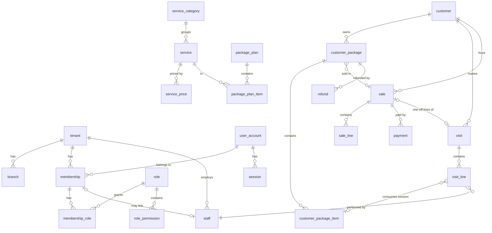

# Data model R1-1 (PostgreSQL, schema `app`)

## Quy ước chung
- **PK:** `id uuid` dạng UUIDv7, sinh trong app. Bảng của tenant có `tenant_id uuid NOT NULL` và `UNIQUE (tenant_id, id)`. **FK luôn kép** `(tenant_id, x_id) → x(tenant_id, id)`, nên không thể trỏ chéo sang spa khác.
- **Role:** `app_rw` là role cấp cluster, **không** tạo trong migration (`infra/postgres-init/01-roles.sql` cho dev/CI; tạo tay một lần trên Supabase ở S11). App runtime kết nối bằng `APP_DATABASE_URL` (app_rw). Migration, compile-time check của sqlx và test dùng `DATABASE_URL` (owner).
- **RLS** bật trên mọi bảng tenant: `USING (tenant_id = current_setting('app.tenant_id', true)::uuid)`, `WITH CHECK` giống hệt. Role `app_rw` không phải owner bảng, không có `BYPASSRLS`.
- **Cột chung:** `created_at timestamptz NOT NULL DEFAULT now()`, `created_by uuid` (user). Bảng có thể bị sửa thêm `updated_at` và `version bigint NOT NULL DEFAULT 1` (optimistic lock, API dùng `If-Match`).
- **Tiền:** `bigint` đồng VND, `CHECK (>= 0)`. **Thời gian:** `timestamptz`. **Ngày nghiệp vụ** `business_date date` do server tính theo `tenant.timezone`, không bao giờ nhận từ client.
- **Văn bản:** chuẩn hóa NFC ở biên. Cột `search_text` = chữ thường, bỏ dấu, `đ→d`, do app tính.
- **Dữ liệu nhạy cảm:** `health_note`, `visit.note` mã hóa ở tầng app bằng AES-256-GCM (`*_ct bytea`, tiền tố phiên bản key). Key nằm trong env `APP_DATA_KEY` (base64, 32 byte), không bao giờ lưu trong DB. Ciphertext = `b'v'` + số phiên bản key + nonce 12 byte + ciphertext; AAD = tenant_id + customer_id nên không chép được ciphertext sang khách khác. Xoay key: thêm `APP_DATA_KEY_V{n}` khi cần (chưa làm).
- **Bảng append-only** (`payment`, `refund`, `audit_log`, `sale_line`): app role chỉ có `INSERT, SELECT`. `payment` và `sale_line` có thêm trigger `app.reject_mutation` (BEFORE UPDATE OR DELETE), chặn cả schema owner (S6).

## ER

## Bảng

### identity / org
| Bảng | Cột chính | Ràng buộc / index |
|---|---|---|
| `tenant` | name, slug, timezone (`Asia/Ho_Chi_Minh`), status, settings `jsonb` (ví dụ `manager_discount_max_pct=10`) | `UNIQUE(slug)`; không RLS (chỉ identity đọc) |
| `branch` | tenant_id, name, address, active | `UNIQUE(tenant_id, name)` |
| `user_account` *(toàn cục, ✅ 0002)* | phone_e164, full_name, password_hash (`$argon2id$`), status (`active`/`disabled`), failed_logins, locked_until. MFA (mfa_secret_ct, mfa_enabled) thêm ở S2b | `UNIQUE(phone_e164)`. Một người có thể làm ở nhiều spa (qua membership) |
| `membership` | tenant_id, user_id, status (liên kết với `staff` để làm "xem dữ liệu của mình" ở R2; S6 chưa thêm) | `UNIQUE(tenant_id, user_id)`; liệt kê spa của user khi login qua hàm `SECURITY DEFINER` `app.tenants_of_user` (chưa có tenant context) |
| `role` | tenant_id, key, name, is_system | `UNIQUE(tenant_id, key)`; seed `owner`, `manager`, `technician` |
| `role_permission` | tenant_id, role_id, permission `text` | PK `(tenant_id, role_id, permission)`; permission phải thuộc danh mục trong code (app kiểm tra khi ghi) |
| `membership_role` | tenant_id, membership_id, role_id | PK cả ba cột |
| `session` *(toàn cục)* | token_hash `bytea`, user_id, active_tenant_id?, created_at, last_seen_at, idle_expires_at, absolute_expires_at, recent_auth_at, ip, user_agent, revoked_at | `UNIQUE(token_hash)`; index `(user_id)` |
| `auth_token` *(toàn cục)* | user_id, purpose (`activate`/`reset`), token_hash, expires_at, used_at | `UNIQUE(token_hash)` |
| `platform_admin` *(toàn cục)* | user_id | |
| `support_grant` | tenant_id, platform_admin_id, granted_by, expires_at, revoked_at | index `(tenant_id, expires_at)` |
| `staff` ✅ 0005 | tenant_id, branch_id, full_name, phone_e164?, position (chữ tự do), status (`active`/`left`), joined_on?, left_on?, version | `CHECK (status='left') = (left_on IS NOT NULL)`; index `(tenant_id, status, full_name)`; không có DELETE. Context khác kiểm tra bằng `org::service::require_active` (khóa `FOR SHARE`) |

### catalog
| Bảng | Cột chính | Ràng buộc / index |
|---|---|---|
| `service_category` | tenant_id, name, sort_order | `UNIQUE(tenant_id, name)` |
| `service` | tenant_id, category_id, name, description, duration_min?, recommended, active, version | `UNIQUE(tenant_id, name)`; `CHECK (duration_min IS NULL OR duration_min > 0)` |
| `service_price` | tenant_id, service_id, variant (`all`/`female`/`male`), amount | PK `(tenant_id, service_id, variant)`. App ép quy tắc: hoặc chỉ có `all`, hoặc ≥ 1 trong `female`/`male`. Thiếu một giới tính = không áp dụng cho giới tính đó |
| `package_plan` | tenant_id, name, price, validity_months?, gift_note, active, version | partial `UNIQUE(tenant_id, name) WHERE active`; `CHECK (validity_months IS NULL OR validity_months > 0)` |
| `package_plan_item` | tenant_id, plan_id, service_id, sessions, bonus_sessions | `CHECK (sessions > 0 AND bonus_sessions >= 0)`; `UNIQUE(tenant_id, plan_id, service_id)` |
Buổi tặng đặt ở **từng dòng** dịch vụ, để gói combo không bị mơ hồ.

### crm
| Bảng | Cột chính | Ràng buộc / index |
|---|---|---|
| `customer` | tenant_id, full_name, search_text, phone_e164, gender? (`female`/`male`), birth_year?, address, source, note, health_note_ct?, anonymized_at?, version | partial `UNIQUE(tenant_id, phone_e164) WHERE anonymized_at IS NULL`; GIN `pg_trgm` trên `search_text` và trên `phone_e164` (tìm theo ≥ 3 chữ số) |

### packages
| Bảng | Cột chính | Ràng buộc / index |
|---|---|---|
| `customer_package` ✅ 0005 | tenant_id, customer_id, plan_id?, name_snapshot, gift_note, sold_price, origin (`sale`/`opening_balance`), sale_id?, closer_staff_id?, starts_on, expires_on?, cancelled_at?, cancel_reason?, version | `CHECK (origin <> 'sale' OR (sale_id IS NOT NULL AND closer_staff_id IS NOT NULL))`; `CHECK (expires_on IS NULL OR expires_on >= starts_on)`; index `(tenant_id, customer_id)` |
| `customer_package_item` ✅ 0005 | tenant_id, customer_package_id, service_id, name_snapshot, sessions_purchased, sessions_bonus, sessions_total (generated = purchased + bonus), sessions_remaining, per_session_value, version | `CHECK (sessions_remaining BETWEEN 0 AND sessions_total)`; index `(tenant_id, customer_package_id)` |

**Trạng thái được suy ra, không lưu**, nên không bao giờ lệch:
- `cancelled` nếu có `cancelled_at`;
- `exhausted` nếu tổng `sessions_remaining` = 0;
- `expired` nếu `expires_on < business_today`;
- còn lại là `active`.

Thứ tự ưu tiên đúng như trên. Không cần job cập nhật trạng thái.

### operations
| Bảng | Cột chính | Ràng buộc / index |
|---|---|---|
| `visit` ✅ 0007 | tenant_id, branch_id, customer_id, business_date, check_in_at, note_ct?, status (`completed`/`voided`), void_reason?, voided_at?, voided_by?, sale_id?, created_by, version. **Không có giờ ra** (EM) | `CHECK (status <> 'voided' OR (void_reason, voided_at, voided_by NOT NULL))`; `UNIQUE(tenant_id, sale_id)` (một sale cho một lượt); index `(tenant_id, branch_id, business_date, check_in_at DESC)`, `(tenant_id, customer_id, check_in_at DESC)`. app_rw: SELECT/INSERT/UPDATE, không DELETE |
| `visit_line` ✅ 0007 | tenant_id, visit_id, position, service_id, service_name_snapshot, source (`package`/`one_off`), customer_package_id?, customer_package_item_id?, sessions_left_after?, staff_id, qty (1–50), price_variant?, unit_price, line_value, expiry_override_reason? | Một `CHECK` theo `source`: `package` cần package + item + `sessions_left_after`, không có `price_variant`; `one_off` không có package, có `price_variant`, `line_value = qty * unit_price`. `unit_price` = giá niêm yết (lẻ) hoặc `per_session_value` (gói); `line_value` = giá trị buổi thực trừ (tặng = 0) → cơ sở hoa hồng R2. index `(tenant_id, visit_id)`, `(tenant_id, staff_id)` (AC4.4), `(tenant_id, customer_package_item_id)` (lịch sử dùng gói). app_rw: SELECT/INSERT + `UPDATE (staff_id)` (sửa KTV) |

### sales
| Bảng | Cột chính | Ràng buộc / index |
|---|---|---|
| `sale` ✅ 0005 | tenant_id, branch_id, customer_id, business_date, subtotal, discount_amount, discount_reason?, total, amount_paid, status (`open`/`voided`), closer_staff_id?, void_reason?, version | `CHECK (total = subtotal - discount_amount AND total >= 0)`; `CHECK (discount_amount = 0 OR discount_reason IS NOT NULL)`; **`CHECK (amount_paid BETWEEN 0 AND total)`** |
| `sale_line` ✅ 0005 *(bất biến)* | tenant_id, sale_id, line_type (`package`/`service`; để mở cho `product`), service_id?, package_plan_id?, customer_package_id?, description_snapshot, qty, unit_price, line_total, position | `CHECK (line_total = qty * unit_price)`; CHECK cột theo `line_type`; `UNIQUE(tenant_id, sale_id, position)`; trigger chặn UPDATE/DELETE |
| `payment` ✅ 0005 *(append-only)* | tenant_id, branch_id, sale_id, business_date, kind (`payment`/`reversal`), method (`cash`/`bank_transfer`), amount, reversal_of?, reference?, paid_at | `CHECK (amount > 0)`; `CHECK ((kind='reversal') = (reversal_of IS NOT NULL))`; `UNIQUE(tenant_id, reversal_of)` (mỗi payment chỉ đảo được 1 lần); index `(tenant_id, branch_id, business_date)`, `(tenant_id, sale_id)` |
| `refund` *(append-only)* | tenant_id, branch_id, customer_package_id, business_date, method, amount, reason | `CHECK (amount > 0)`; `reason NOT NULL` |

**Công nợ:** hoãn (EM 2026-11-04). R1 luôn ghi `amount_paid = total`. Cột và `CHECK` được giữ lại để sau này bật công nợ bằng cách thêm view `receivable`, không cần đổi schema.

### kernel
| Bảng | Cột chính | Ràng buộc / index |
|---|---|---|
| `idempotency_record` | tenant_id, actor_user_id, key, request_hash, response_status, response_body `jsonb`, created_at | PK `(tenant_id, actor_user_id, key)`; claim + complete trong **cùng transaction** với use case; job dọn > 48 giờ qua hàm `SECURITY DEFINER` `app.purge_idempotency_records` (app_rw không cần BYPASSRLS) |
| `audit_log` *(append-only)* | tenant_id?, actor_user_id, actor_kind (`user`/`platform_admin`/`system`), action, entity_type, entity_id, before `jsonb`, after `jsonb`, reason?, ip, at | index `(tenant_id, entity_type, entity_id, at)`. Trường sức khỏe ghi `"[redacted]"` |

## Migrations (forward-only, `sqlx migrate`)
`0001_kernel` ✅ (pg_trgm, schema `app`, `app.current_tenant()`, tenant, branch, audit_log, idempotency_record, RLS + grants) → `0002_identity_org` → `0003_catalog` → `0004_crm` ✅ → `0005_sales_packages` ✅ (staff, sale, sale_line, payment, customer_package, customer_package_item) → `0006_mfa` ✅ (S2b) → `0007_visits` ✅ (S7: visit, visit_line) → `0008` (S9) → …. Kế hoạch tách riêng migration RLS/grants ban đầu đã bỏ: mỗi migration tự bật RLS và cấp quyền cho bảng của nó.

Thay đổi về sau theo **expand → backfill theo lô → kiểm tra → contract**. Mỗi migration được test trên snapshot giống production.

## Seed
Dữ liệu tenant Viên Phúc Y Đường: 1 chi nhánh (Phường Đông Hà), 10 nhóm và 35 dịch vụ từ [service-catalog](../product/service-catalog.md), role hệ thống, tài khoản chủ spa. Giá "Ôn ấm tử cung" và các gói liệu trình: chờ EM.
