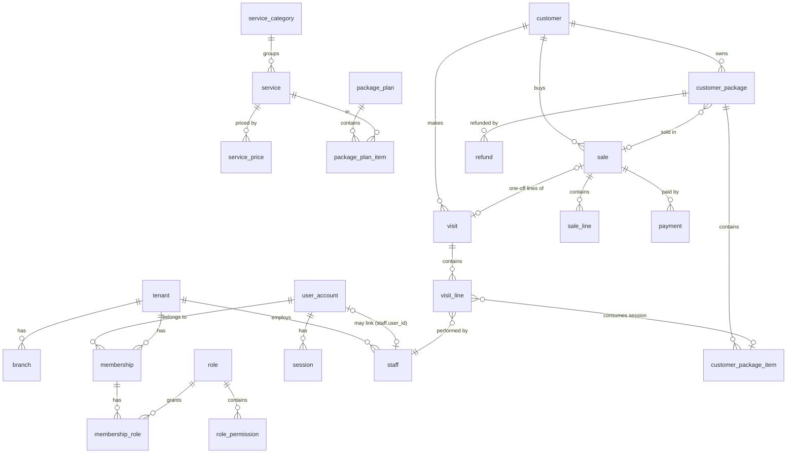

# Data model R1-1 (PostgreSQL, schema `app`)

## Quy ước chung
- **PK:** `id uuid` dạng UUIDv7, sinh trong app. Bảng của tenant có `tenant_id uuid NOT NULL` và `UNIQUE (tenant_id, id)`. **FK luôn kép** `(tenant_id, x_id) → x(tenant_id, id)`, nên không thể trỏ chéo sang spa khác.
- **Role:** `app_rw` là role cấp cluster, **không** tạo trong migration (`infra/postgres-init/01-roles.sql` cho dev/CI; tạo tay một lần trên Supabase ở S11). App runtime kết nối bằng `APP_DATABASE_URL` (app_rw). Migration, compile-time check của sqlx và test dùng `DATABASE_URL` (owner).
- **RLS** bật trên mọi bảng tenant, policy `tenant_isolation`: `USING (tenant_id = app.current_tenant())`, `WITH CHECK` giống hệt. `app.current_tenant()` (0001) = `nullif(current_setting('app.tenant_id', true), '')::uuid`, nên chưa đặt tenant thì không thấy dòng nào (deny by default). Role `app_rw` không phải owner bảng, không có `BYPASSRLS`. Bảng toàn cục (`user_account`, `session`, `mfa_recovery_code`) không RLS, chỉ crate `identity` đọc; bảng `platform_*` có RLS + policy `runtime_only` cho `app_rw` (0038); `maintenance_run` RLS không policy (0035).
- **Cột chung:** `created_at timestamptz NOT NULL DEFAULT now()`; bảng ghi nghiệp vụ có `created_by uuid` (user, FK → `user_account` ở các bảng HR / follow-up, thêm cho lượt, hóa đơn, thanh toán, hoàn tiền, gói, lịch hẹn ở 0036). Bảng có thể bị sửa thêm `updated_at` và `version bigint NOT NULL DEFAULT 1` (optimistic lock, API dùng `If-Match`).
- **Tiền:** `bigint` đồng VND, `CHECK (>= 0)`. **Thời gian:** `timestamptz`. **Ngày nghiệp vụ** `business_date date` do server tính theo `tenant.timezone`, không bao giờ nhận từ client.
- **Văn bản:** chuẩn hóa NFC ở biên. Cột `search_text` = chữ thường, bỏ dấu, `đ→d`, do app tính.
- **Dữ liệu nhạy cảm:** `customer.health_note_ct`, `visit.note_ct`, `sale.note_ct` (và bí mật TOTP `user_account.mfa_secret_ct`, `platform_operator.mfa_secret_ct`) mã hóa ở tầng app bằng AES-256-GCM (`kernel::crypto::FieldCipher`). Key nằm trong env `APP_DATA_KEY` (base64, 32 byte), không bao giờ lưu trong DB. Ciphertext = `b'v'` + số phiên bản key + nonce 12 byte + ciphertext; AAD = mục đích + id của bản ghi (`kernel::crypto::record_aad`: `customer.health_note` + tenant + khách, `visit.note` + tenant + lượt, `sale.note` + tenant + hóa đơn, `user.mfa_secret` + tài khoản), nên không chép được ciphertext sang bản ghi khác. Xoay key: chưa làm (mới có phiên bản key 1).
- **Bảng append-only** (`payment`, `refund`, `audit_log`, `sale_line`, `customer_follow_up`, `customer_package_extension`, `payslip`, `platform_audit_log`): app role chỉ có `INSERT, SELECT`. Mọi bảng trên trừ `audit_log` và `platform_audit_log` có thêm trigger `app.reject_mutation` (BEFORE UPDATE OR DELETE), chặn cả schema owner (S6, S8). `staff_adjustment` chỉ được hủy một lần (0024, `staff_adjustment_void_only`).
- **Sửa sai bằng bút toán đảo (S8, 0009):** hủy hóa đơn thêm một dòng `payment.kind='reversal'` cho mỗi payment (cùng sale, method, amount; `business_date` = ngày hủy). Trigger `payment_reversal_mirrors_original` kiểm tra điều đó và chặn đảo một reversal; `UNIQUE (tenant_id, reversal_of)` chặn đảo 2 lần. Trạng thái chỉ đi tới: trigger `visit_voided_is_final`, `sale_voided_is_final`, `customer_package_cancelled_is_final` chặn mọi UPDATE sau khi `voided`/`cancelled`; `customer_package_item_no_restore_when_cancelled` chặn cộng buổi vào gói đã hủy. CHECK: sale `voided` phải có `voided_by`, `amount_paid = 0`, lý do 1–500; gói `cancelled` phải có `cancelled_by` + lý do.

## ER
Chỉ các bảng lõi của R1-1. Lịch hẹn, nhân sự / lương, follow-up, gia hạn gói và admin nền tảng có ở các mục bên dưới; ER theo nhóm của toàn bộ schema: [docs/database-design.md](../../../docs/database-design.md).

## Bảng

### identity / org
| Bảng | Cột chính | Ràng buộc / index |
|---|---|---|
| `tenant` | name, slug, timezone (`Asia/Ho_Chi_Minh`), status (`active`/`suspended`), settings `jsonb` (ví dụ `manager_discount_max_pct`, `opening_hours`, `slot_minutes`) | `UNIQUE(slug)` + CHECK dạng slug; RLS `tenant_self` (`id = app.current_tenant()`); `app_rw` chỉ `SELECT` (tạo spa / đổi trạng thái qua hàm `app.platform_insert_tenant` / `platform_set_tenant_status`, 0038, hoặc CLI bằng owner) |
| `branch` | tenant_id, name, address, active | `UNIQUE(tenant_id, name)` |
| `user_account` *(toàn cục, ✅ 0002)* | phone_e164, full_name, password_hash (`$argon2id$`), status (`active`/`disabled`), failed_logins, locked_until; MFA (0006): mfa_secret_ct, mfa_enabled_at, mfa_last_step (chống dùng lại mã); 0032: must_change_password, password_changed_at | `UNIQUE(phone_e164)` + CHECK `^\+84[0-9]{9}$` (từ 0047/0048: `^\+84[35789][0-9]{8}$`, chỉ di động); CHECK `mfa_enabled_at` cần `mfa_secret_ct`. Một người có thể làm ở nhiều spa (qua membership) |
| `mfa_recovery_code` *(toàn cục, 0006)* | user_id, code_hash (SHA-256 của id tài khoản + mã), created_at, used_at | `UNIQUE(code_hash)`; index `(user_id) WHERE used_at IS NULL` |
| `membership` | tenant_id, user_id, status (`active`/`disabled`) | `UNIQUE(tenant_id, user_id)`; liệt kê spa của user khi login qua hàm `SECURITY DEFINER` `app.tenants_of_user` (chưa có tenant context). Hồ sơ nhân viên gắn với tài khoản qua `staff.user_id` (0017), không qua membership |
| `role` | tenant_id, key, name, is_system, requires_mfa (0006), follows_template (0040) | `UNIQUE(tenant_id, key)`; seed `owner`, `manager`, `technician` (từ `role_template_permission`, 0040); CHECK `role_owner_requires_mfa` (role hệ thống owner luôn bắt MFA) |
| `role_permission` | tenant_id, role_id, permission `text` | PK `(tenant_id, role_id, permission)`; CHECK dạng `a.b`; permission phải thuộc danh mục trong code (`kernel::permission`, app kiểm tra khi ghi) |
| `membership_role` | tenant_id, membership_id, role_id | PK cả ba cột |
| `session` *(toàn cục)* | token_hash `bytea` (SHA-256 của cookie), user_id, active_tenant_id?, created_at, last_seen_at, idle_expires_at, absolute_expires_at, recent_auth_at (không default từ 0011), mfa_pending (0006), ip, user_agent, revoked_at | `UNIQUE(token_hash)`; index `(user_id) WHERE revoked_at IS NULL`; CHECK `idle_expires_at <= absolute_expires_at`; xóa 30 ngày sau khi thu hồi / hết hạn (`app.purge_sessions`, 0035). Mỗi request đọc qua `app.session_actor` (0034/0039) |
| `auth_token` *(kế hoạch, chưa tạo)* | user_id, purpose (`activate`/`reset`), token_hash, expires_at, used_at | Không có migration nào tạo bảng này: mật khẩu tạm + `password_reset_request` (0032, ADR-0016) thay cho link kích hoạt / đặt lại |
| `platform_admin` *(kế hoạch, chưa tạo)* | user_id | Thay bằng principal riêng `platform_operator` (0038, ADR-0018), không phải user của spa |
| `support_grant` *(kế hoạch, chưa tạo)* | tenant_id, platform_admin_id, granted_by, expires_at, revoked_at | Chưa có bảng; permission `support_grant.manage` vẫn có trong code |
| `password_reset_request` ✅ 0032 | tenant_id, user_id, requested_at, expires_at (24 h), closed_at, outcome (`reset`/`dismissed`/`expired`), closed_by | unique một phần `(tenant_id, user_id) WHERE closed_at IS NULL`; RLS `tenant_isolation`. `user_account.must_change_password` cùng migration |
| `staff` ✅ 0005 | tenant_id, branch_id, full_name, phone_e164?, position (chữ tự do), status (`active`/`left`), joined_on?, left_on?, version; `user_id?`, `shift_start?` (0017), `note?` (0025) | `CHECK (status='left') = (left_on IS NOT NULL)`; index `staff_status_idx (tenant_id, status, full_name)`, `staff_active_name_idx` (0025), unique `staff_user_idx (tenant_id, user_id)` (0017); không có DELETE. `status / joined_on / left_on` là bản sao của đợt làm việc mới nhất (`staff_employment`, 0025). Context khác kiểm tra bằng `org::service::require_active` (khóa `FOR SHARE`) |

### catalog
| Bảng | Cột chính | Ràng buộc / index |
|---|---|---|
| `service_category` | tenant_id, name, sort_order | `UNIQUE(tenant_id, name)` |
| `service` | tenant_id, category_id, name, description, duration_min? (NULL = "theo tư vấn"), recommended, active, sort_order, version | `UNIQUE(tenant_id, name)`; `CHECK (duration_min IS NULL OR duration_min BETWEEN 1 AND 600)`; index `(tenant_id, category_id, sort_order)`; không DELETE (ngừng bán = `active = false`) |
| `service_price` | tenant_id, service_id, variant (`all`/`female`/`male`), amount | PK `(tenant_id, service_id, variant)`. App ép quy tắc: hoặc chỉ có `all`, hoặc ≥ 1 trong `female`/`male`. Thiếu một giới tính = không áp dụng cho giới tính đó |
| `package_plan` | tenant_id, name, price, validity_months?, gift_note, active, version | partial `UNIQUE(tenant_id, name) WHERE active` (`package_plan_active_name_uq`); `CHECK (validity_months IS NULL OR validity_months BETWEEN 1 AND 120)` |
| `package_plan_item` | tenant_id, plan_id, service_id, sessions, bonus_sessions | `CHECK (sessions BETWEEN 1 AND 500)`, `bonus_sessions BETWEEN 0 AND 500`; `UNIQUE(tenant_id, plan_id, service_id)` |
Buổi tặng đặt ở **từng dòng** dịch vụ, để gói combo không bị mơ hồ.

### crm
| Bảng | Cột chính | Ràng buộc / index |
|---|---|---|
| `customer` | tenant_id, full_name? (NULL từ 0023 = "Khách vãng lai"), search_text, phone_e164? (tùy chọn từ 0023), gender? (`female`/`male`), birth_year?, birth_date? (0023), address, source, note, health_note_ct?, anonymized_at?, version | partial `UNIQUE(tenant_id, phone_e164) WHERE anonymized_at IS NULL` (`customer_phone_uq`); index `customer_note_updated_idx` (0027). Không có index tìm kiếm: hai GIN `pg_trgm` của 0004 đã bỏ ở 0033 vì dưới RLS không dùng được; tìm theo tên / SĐT là `LIKE` quét khách của spa (`crm::repo`) |

### packages
| Bảng | Cột chính | Ràng buộc / index |
|---|---|---|
| `customer_package` ✅ 0005 (+ `cancelled_by` 0009) | tenant_id, customer_id (người dùng gói), plan_id?, name_snapshot, gift_note, sold_price, origin (`sale`/`opening_balance`), sale_id?, closer_staff_id?, starts_on, expires_on?, cancelled_at?, cancel_reason?, cancelled_by?, created_by, version | `customer_package_sale_origin CHECK (origin <> 'sale' OR sale_id IS NOT NULL)` (0021; bản 0005 bắt buộc thêm `closer_staff_id`); trigger `customer_package_sale_link` (0018) thay CHECK "gói sổ giấy không có `sale_id`"; `CHECK (expires_on IS NULL OR expires_on >= starts_on)`; `customer_package_cancel_complete` (0009); index `(tenant_id, customer_id, created_at DESC)`, `(tenant_id, sale_id) WHERE sale_id IS NOT NULL`, `customer_package_cancelled_at_idx` (0027) |
| `customer_package_item` ✅ 0005 | tenant_id, customer_package_id, service_id, name_snapshot, sessions_purchased (0–500), sessions_bonus (0–500), sessions_total (generated = purchased + bonus), sessions_remaining, per_session_value, version | `CHECK (sessions_remaining BETWEEN 0 AND sessions_purchased + sessions_bonus)`, `CHECK (purchased + bonus > 0)`; `UNIQUE(tenant_id, customer_package_id, service_id)` (cũng là index tra theo gói) |

**Trạng thái được suy ra, không lưu**, nên không bao giờ lệch:
- `cancelled` nếu có `cancelled_at`;
- `exhausted` nếu tổng `sessions_remaining` = 0;
- `expired` nếu `expires_on < business_today`;
- còn lại là `active`.

Thứ tự ưu tiên đúng như trên. Không cần job cập nhật trạng thái.

### operations
| Bảng | Cột chính | Ràng buộc / index |
|---|---|---|
| `visit` ✅ 0007 | tenant_id, branch_id, customer_id, business_date, check_in_at, note_ct?, status (`completed`/`voided`), void_reason?, voided_at?, voided_by?, sale_id? (hóa đơn lẻ đầu tiên), created_by, version; `corrects_visit_id?` (0020), `companions text[]` (0021). **Không có giờ ra** (EM) | `CHECK (status <> 'voided' OR (void_reason, voided_at, voided_by NOT NULL))`; `UNIQUE(tenant_id, sale_id)`; index `visit_customer_idx (tenant_id, customer_id, check_in_at DESC)`, `visit_tenant_day_idx (tenant_id, business_date)` (0013), `visit_day_status_idx` (0017), `visit_note_day_idx`, `visit_voided_at_idx` (0027). `visit_day_idx` (dẫn đầu `branch_id`) của 0007 đã bỏ ở 0033. app_rw: SELECT/INSERT/UPDATE, không DELETE |
| `visit_line` ✅ 0007 | tenant_id, visit_id, position, service_id, service_name_snapshot, source (`package`/`one_off`), customer_package_id?, customer_package_item_id?, sessions_left_after?, staff_id, qty (1–50), price_variant?, unit_price, line_value, expiry_override_reason?; `discount_amount` (0016), `sale_id?`, `referrer_staff_id?` (0021) | `visit_line_check` theo `source` (bản 0016): `package` cần package + item + `sessions_left_after`, không có `price_variant`, `discount_amount = 0`; `one_off` không có package, có `price_variant`, `line_value = qty * unit_price - discount_amount`. `unit_price` = giá niêm yết (lẻ) hoặc `per_session_value` (gói); `line_value` = giá trị buổi thực trừ (tặng = 0) → cơ sở hoa hồng. `UNIQUE (tenant_id, visit_id, position)` (cũng là index tra theo lượt; `visit_line_visit_idx` bỏ ở 0033); index `(tenant_id, staff_id)` (AC4.4), `(tenant_id, customer_package_item_id)` (lịch sử dùng gói), `visit_line_package_idx` (0013), `visit_line_sale_idx`, `visit_line_referrer_idx` (0021). app_rw: SELECT/INSERT + `UPDATE (staff_id)` (sửa KTV) |

### sales
| Bảng | Cột chính | Ràng buộc / index |
|---|---|---|
| `sale` ✅ 0005 | tenant_id, branch_id, customer_id (người trả), business_date, subtotal, discount_amount, discount_reason?, total, amount_paid, status (`open`/`voided`), closer_staff_id?, void_reason?, voided_at?, voided_by?, created_by, version; `source` (`app`/`paper_book`, 0018), `visit_id?` (0021), **note_ct?** (0030, "Ghi chú gói" mã hóa, AAD `sale.note` + tenant + hóa đơn; chỉ hóa đơn gói) | `CHECK (total = subtotal - discount_amount AND total >= 0)`; `CHECK (discount_amount = 0 OR discount_reason IS NOT NULL)`; **`CHECK (amount_paid BETWEEN 0 AND total)`**; `sale_void_complete` (0009); index `sale_customer_idx (tenant_id, customer_id, created_at DESC)`, `sale_tenant_day_idx` (0013), `sale_closer_day_idx` (0017), `sale_visit_idx` (0021), `sale_voided_at_idx` (0027), `sale_discount_day_idx` (0028), `sale_note_day_idx` (0030). `sale_day_idx` (dẫn đầu `branch_id`) bỏ ở 0033 |
| `sale_line` ✅ 0005 *(bất biến)* | tenant_id, sale_id, line_type (`package`/`service`; để mở cho `product`), service_id?, package_plan_id?, customer_package_id?, description_snapshot, qty, unit_price, line_total, position | `CHECK (line_total = qty * unit_price)`; CHECK cột theo `line_type` (dòng gói: `sale_line_package_shape` từ 0018, không còn bắt `package_plan_id`); `UNIQUE(tenant_id, sale_id, position)` (cũng là index tra theo hóa đơn; `sale_line_sale_idx` bỏ ở 0033); trigger chặn UPDATE/DELETE |
| `payment` ✅ 0005 *(append-only)* | tenant_id, branch_id, sale_id, business_date, kind (`payment`/`reversal`), method (`cash`/`bank_transfer`), amount, reversal_of?, reference?, paid_at, created_by | `CHECK (amount > 0)`; `CHECK ((kind='reversal') = (reversal_of IS NOT NULL))`; `UNIQUE(tenant_id, reversal_of)` (mỗi payment chỉ đảo được 1 lần); trigger `payment_reversal_mirrors_original` (0009); index `payment_sale_idx (tenant_id, sale_id)`, `payment_tenant_day_idx (tenant_id, business_date)` (0013; `payment_day_idx` theo chi nhánh bỏ ở 0033) |
| `refund` ✅ 0009 *(append-only)* | tenant_id, branch_id, customer_id, customer_package_id, business_date, method (`cash`/`bank_transfer`), amount, reason, created_by | `CHECK (amount > 0)`; `reason` 1–500; `UNIQUE (tenant_id, customer_package_id)` (một gói hoàn 1 lần); trigger `refund_within_paid` (amount ≤ `sold_price`); trigger `reject_mutation`; app_rw chỉ `SELECT, INSERT`; index `refund_tenant_day_idx (tenant_id, business_date)` cho sổ quỹ, `refund_customer_idx` (0013; `refund_day_idx` theo chi nhánh bỏ ở 0033) |

**Công nợ:** hoãn (EM 2026-11-04). R1 luôn ghi `amount_paid = total`. Cột và `CHECK` được giữ lại để sau này bật công nợ bằng cách thêm view `receivable`, không cần đổi schema.

### kernel
| Bảng | Cột chính | Ràng buộc / index |
|---|---|---|
| `idempotency_record` | tenant_id, actor_user_id, key, request_hash (32 byte), response_status, response_body `jsonb`, created_at | PK `(tenant_id, actor_user_id, key)`; index `(created_at)`; claim + complete trong **cùng transaction** với use case; job dọn > 48 giờ qua hàm `SECURITY DEFINER` `app.purge_idempotency_records` (app_rw không có DELETE, không cần BYPASSRLS) |
| `audit_log` *(append-only)* | tenant_id?, actor_user_id, actor_kind (`user`/`platform_admin`/`system`), action, entity_type, entity_id, before `jsonb`, after `jsonb`, reason?, ip, at | index `audit_log_entity_idx (tenant_id, entity_type, entity_id, at)`, `audit_log_tenant_at_idx (tenant_id, at DESC)` (0038). Trường sức khỏe ghi `"[redacted]"`; audit hồ sơ khách chỉ ghi cờ có/không và tên trường đã đổi, không ghi tên / SĐT / ngày sinh (0047, ADR-0019 D13). Giữ hết, không có hạn (EM Q-DB4) |
| `maintenance_run` (0035) | job (PK), last_run_at | Không grant, RLS không policy; chỉ hàm `app.claim_maintenance(job, every)` chạm tới (một instance chạy mỗi job mỗi khoảng) |

## Migrations (forward-only, `sqlx migrate`)
File ở `apps/api/migrations/`, mới nhất **0040**. Số **0008, 0010, 0031 không có file**: được giữ chỗ (0008 cho S9, 0010 cho S10, 0031 cho một thay đổi về chức danh mà [ADR-0015](../decisions/ADR-0015-own-profile-out-of-the-books.md) giải bằng code) rồi không dùng; sqlx chỉ cần số tăng dần nên khoảng trống vô hại.

| Migration | Nội dung (chi tiết ở mục tương ứng bên dưới) |
|---|---|
| `0001_kernel` | `pg_trgm`, schema `app`, `app.current_tenant()`, tenant, branch, audit_log, idempotency_record + `app.purge_idempotency_records`, RLS + grants |
| `0002_identity` | user_account, session, membership, role, role_permission, membership_role, `app.tenants_of_user` |
| `0003_catalog` · `0004_crm` | service_category, service, service_price, package_plan, package_plan_item · customer |
| `0005_sales_packages` | staff, sale, customer_package, customer_package_item, sale_line, payment, `app.reject_mutation` |
| `0006_mfa` | `role.requires_mfa`, cột MFA của user_account, mfa_recovery_code, `session.mfa_pending`, `app.user_requires_mfa` |
| `0007_visits` | visit, visit_line |
| `0009_void_lifecycle` | reversal, trigger trạng thái chỉ đi tới, `customer_package.cancelled_by`, refund |
| `0011_security_review` | H1 (`session.recent_auth_at` bỏ default), M3 (`user_requires_mfa` bỏ điều kiện spa active), M2 (`opening_balance_window`, `refund_cap`: đã gỡ ở 0012) |
| `0012_simplify_owner_and_opening_balance` | EM 2026-11-05: bỏ `opening_balance_window`, quyền `opening_balance.manage_window`, cột `refund_cap`; `refund_within_paid` về lại `amount ≤ sold_price`. 0011 có thể đã chạy trên staging nên không sửa, chỉ thêm 0012 |
| `0013_management_views` | Read models R1-2 |
| `0014_follow_ups_and_search` · `0015_long_range_reports` | customer_follow_up, `app.search_fold` · quyền `report.long_range` |
| `0016_appointments` | appointment, appointment_service, `visit_line.discount_amount`, quyền `appointment.manage`, `visit.backdate` |
| `0017_staff_management` | Quản lý nhân viên, lương |
| `0018_paper_book_sales` | Tiền sổ giấy là hóa đơn |
| `0019_calendar_timeline` · `0020_visit_corrections` | `appointment.group_id`, appointment_setting · `visit.corrects_visit_id` |
| `0021_upsell_in_visit` · `0022_served_companions` | Upsell trong lượt · Người đi cùng được làm |
| `0023_customer_identity` · `0024_adjustment_void` | Danh tính khách, customer_package_extension · hủy thưởng/phạt |
| `0025_staff_roster` · `0026_former_staff_login` | staff_employment · người đã nghỉ giữ đăng nhập (ADR-0014) |
| `0027`–`0029` notes journal · `0030_package_sale_note` | Nhật ký ghi chú (chỉ index) · `sale.note_ct` |
| `0032_staff_logins_and_passwords` | `must_change_password`, password_reset_request (ADR-0016) |
| `0033_drop_redundant_indexes` … `0037_validate_actor_foreign_keys` | Rà soát 2026-11 |
| `0038_platform_admin` · `0039_feature_flags` · `0040_roles_and_accounts` | Admin nền tảng (ADR-0018) |

Từ 0016 crate `kernel` có `build.rs` (`rerun-if-changed=../../migrations`): trước đó thêm file migration mới không làm build lại migrator nhúng, `app migrate` lặng lẽ bỏ qua nó. Kế hoạch tách riêng migration RLS/grants ban đầu đã bỏ: mỗi migration tự bật RLS và cấp quyền cho bảng của nó.

Thay đổi về sau theo **expand → backfill theo lô → kiểm tra → contract**. Mỗi migration được test trên snapshot giống production.

## Lịch hẹn, nhập bù, giảm giá lượt (0016, vòng 4, [spec](../product/specs/appointments.md))
- **`app.appointment`**: id, tenant_id, branch_id, `customer_id?` **hoặc** (`guest_name`, `guest_phone` E.164) (CHECK đúng một; từ 0022 `guest_phone` tùy chọn trong nhóm, xem mục 0022), `business_date`, `starts_at`, `ends_at` (> starts, ≤ 8 giờ), `staff_id?`, `status` ∈ booked/arrived/done/no_show/cancelled, `note ≤ 500` (không phải dữ liệu sức khỏe), `status_reason` (bắt buộc với no_show/cancelled), `arrived_at` (bắt buộc khi arrived, cùng `staff_id`), `closed_at/closed_by` (đúng khi done/no_show/cancelled), `visit_id` (đúng khi done; `UNIQUE (tenant_id, visit_id)`, FK → visit), created_by/at, updated_at, `version`. FK tenant-scoped tới branch, customer, staff, visit.
  - `EXCLUDE USING gist (tenant_id =, staff_id =, tstzrange(starts_at, ends_at) &&) WHERE status IN ('booked','arrived') AND staff_id IS NOT NULL` (extension `btree_gist`, trusted). Lớp thứ hai sau khóa advisory theo (spa, ngày) của service.
  - Trigger `appointment_closed_is_final`: lịch đã done/no_show/cancelled không UPDATE được nữa (0020 nới đúng một ngoại lệ, xem dưới).
  - Index `appointment_day_idx (tenant_id, business_date, starts_at)` (lịch ngày/tuần), `appointment_customer_idx (tenant_id, customer_id, starts_at DESC) WHERE customer_id IS NOT NULL`; sau này thêm `appointment_group_idx` (0019), `appointment_note_created_idx` (0028), `appointment_closed_reason_idx` (0029).
  - app_rw: `SELECT, INSERT, UPDATE` (không DELETE). RLS `tenant_isolation`.
- **`app.appointment_service`** (tenant_id, appointment_id, position 0–4, service_id, service_name_snapshot): app_rw `SELECT, INSERT, DELETE` (thay danh sách khi đổi lịch). RLS.
- **`visit_line.discount_amount`** `bigint ≥ 0` (mặc định 0): phần giảm giá của lượt chia cho dòng lẻ. CHECK `visit_line_check` thay bằng bản mới: dòng gói `discount_amount = 0`; dòng lẻ `discount_amount ≤ qty × unit_price` và `line_value = qty × unit_price − discount_amount`. Dữ liệu cũ hợp lệ ngay (mặc định 0).
- **Quyền:** `appointment.manage` cho role hệ thống owner + manager, `visit.backdate` cho owner.
- **0019 (vòng 5, [spec §10](../product/specs/appointments.md)):**
  - `appointment.group_id uuid NULL`: các lịch đặt cùng lúc cho một nhóm / gia đình (mỗi người vẫn là một lịch, một lượt, một thanh toán). Index `(tenant_id, group_id) WHERE group_id IS NOT NULL`. Không có bảng nhóm (nhóm chỉ là id chung), nên không FK.
  - **`app.appointment_setting`** (tenant_id PK → tenant, `max_per_slot int NULL CHECK 1–200`, updated_by, updated_at): số khách tối đa mỗi khung giờ, **chỉ để cảnh báo**, NULL = không giới hạn. Bảng riêng thay vì `tenant.settings` để app_rw không cần UPDATE trên `app.tenant`. app_rw `SELECT, INSERT, UPDATE` (không DELETE), RLS `tenant_isolation`. Ghi bằng upsert, audit `appointment.settings` (before/after).
  - Quyền `appointment.settings` cho role hệ thống owner.
  - "Đang làm" **không** có cột: suy ra từ `arrived_at` và `visit.check_in_at` + thời lượng dịch vụ mỗi lần đọc lịch.
  - Lịch đọc thêm lượt vãng lai: `visit` các ngày trong chi nhánh mà không lịch nào trỏ tới (`NOT EXISTS … appointment.visit_id`, dùng index `UNIQUE (tenant_id, visit_id)`); dòng lượt một query, không N+1. (Lúc viết dùng `visit_day_idx` và `visit_line_visit_idx`; cả hai bỏ ở 0033, nay là `visit_tenant_day_idx` và `UNIQUE (tenant_id, visit_id, position)`.)
- **0020 Sửa lượt ([spec US6b](../product/specs/front-desk-and-packages.md)):**
  - `visit.corrects_visit_id uuid NULL`, FK `(tenant_id, corrects_visit_id) → visit`, `UNIQUE (tenant_id, corrects_visit_id)` (mỗi lượt bị thay tối đa một lần, cũng là index tra ngược "corrected by"), `CHECK (corrects_visit_id <> id)`. Liên kết chỉ nằm ở **lượt mới**: lượt cũ đã `voided` không được UPDATE nữa (trigger 0009); `corrected_by_visit_id` trong DTO = join ngược.
  - Trigger `visit_correction_link` (BEFORE INSERT OR UPDATE): lượt bị thay phải `voided` và cùng `business_date`; liên kết bất biến.
  - `appointment_closed_is_final` thay bằng bản cho phép đúng một thay đổi trên lịch `done`: `visit_id` chuyển sang lượt có `corrects_visit_id` = lượt cũ (các cột khác trừ `version`, `updated_at` phải y nguyên).
  - Không đổi `sale`, `payment`, `visit_line`: tiền/buổi đi qua đúng đường hủy (reversal, cộng buổi) + ghi lượt mới; sổ doanh thu (`revenue_book`) hiện hóa đơn cũ đã hủy với lý do "Sửa lượt: …". Bất biến "hóa đơn có dòng gói = liệu trình" giữ nguyên vì lượt sửa chỉ tạo hóa đơn dịch vụ lẻ.
- Nhập bù không cần cột mới: `visit.check_in_at` vốn là giờ làm, `business_date` của visit/sale/payment = ngày của giờ làm; `created_at`/`paid_at` vẫn là lúc ghi thật.

## Tiền sổ giấy là hóa đơn (0018, EM 2026-11-05)
- `sale.source` (`app` mặc định | `paper_book`): đánh dấu ẩn cho audit và chạy lại; API không bao giờ trả.
- Bỏ CHECK cũ "gói `opening_balance` không có `sale_id`"; thay bằng trigger `customer_package_sale_link`: gói bán trong app không bao giờ đổi `sale_id`; gói sổ giấy chỉ được gắn **một lần** (NULL → id) vào hóa đơn `paper_book` của **cùng khách**; không gỡ, không gắn lại.
- Dòng `sale_line` loại gói không còn bắt buộc `package_plan_id` (gói sổ giấy có thể không khớp gói nào trong bảng giá); vẫn bắt buộc `customer_package_id`.
- Hóa đơn sổ giấy = 1 dòng gói + 1 `payment` (`business_date = paid_on`, `paid_at`/`created_at` = 12:00 ngày đó giờ spa). Vì là `payment` thường nên sổ doanh thu, báo cáo, lịch sử, "Đã chi" tự tính; append-only như mọi khoản tiền. Hủy hóa đơn này chỉ đảo tiền (`lock_packages_of_sale` chỉ khóa/hủy gói `origin = 'sale'`).

## Follow-up khách vắng + tìm không dấu (0014, vòng 3)
- Bảng `app.customer_follow_up` (id, tenant_id, customer_id → customer (tenant_id, id), contacted_on date, channel ∈ phone/zalo/in_person/other, outcome ∈ will_come/not_interested/no_answer/other, note ≤ 500, next_follow_up_on ≥ contacted_on, created_by → user_account, created_at). **Chỉ thêm**: trigger `reject_mutation` cho UPDATE/DELETE, app_rw chỉ `SELECT, INSERT`. RLS `tenant_isolation`. Index `(tenant_id, customer_id, contacted_on DESC, created_at DESC)` cho "lần liên lạc gần nhất" (LATERAL trong `/customers/inactive`).
- Quyền `customer.follow_up` cho role hệ thống owner + manager.
- Hàm `app.search_fold(text)` (IMMUTABLE): NFC → bỏ dấu tiếng Việt → đ→d → lowercase → gộp khoảng trắng; bản SQL của `crm::text::search_key` cho tên chỉ có dạng snapshot (dịch vụ, gói, danh mục, KTV). Test `follow_ups.rs::sql_folding_matches_the_rust_search_key` so hai bản trên mọi chữ có dấu, hoa/thường, NFC/NFD.

## Read models R1-2 (0013, [spec](../product/specs/management-views.md))
Không có bảng mới. 0013:
- **Quyền:** thêm `report.read`, `report.revenue.read` cho role hệ thống owner + manager đã có; xóa `opening_balance.import` khỏi role hệ thống manager.
- **`app.package_status(cancelled_at, sessions_remaining, expires_on, today) → text`** (`IMMUTABLE`): định nghĩa SQL duy nhất của trạng thái suy ra, khớp `PackageStatus::derive` (test so trạng thái của `GET /packages` với `GET /customer-packages/{id}`).
- **View `app.customer_package_state`**: gói + tổng/còn lại cộng từ items.
- **View `app.revenue_book`**: sổ doanh thu suy ra: một dòng mỗi hóa đơn (tiền nhận theo CK/TM, chưa thanh toán = total − đã nhận, mô tả dòng lẻ / gói), một dòng âm mỗi (hóa đơn, ngày hủy) từ các `reversal`, một dòng âm mỗi `refund`. Cột `seq` = UUIDv7 do API sinh (hóa đơn / reversal mới nhất / refund) để thứ tự trong ngày đúng thứ tự ghi, không phụ thuộc đồng hồ DB vs API. Nhánh hóa đơn dùng `LATERAL`, không `GROUP BY` cột ngoài khóa, nên điều kiện `tenant_id`/`business_date` của người gọi được đẩy xuống từng nhánh.
- Cả hai view `WITH (security_invoker = true)` (PG ≥ 15; dev/CI/Supabase đều PG ≥ 16): chạy bằng quyền người gọi, RLS của bảng gốc vẫn áp cho `app_rw`. `GRANT SELECT` cho `app_rw`.
- **Index** (bench 3 năm: mọi index mới đều được dùng, các index ngày cũ dẫn đầu bằng `branch_id` có 0 lượt quét): `sale/payment/visit/refund (tenant_id, business_date)`, `visit_line (tenant_id, customer_package_id) WHERE NOT NULL` (trang liệu trình, "dùng lần cuối"), `refund (tenant_id, customer_id)`.
- `customer_package.origin` vẫn giữ trong DB (gói sổ giấy không có hóa đơn nên không bao giờ thành doanh thu), nhưng không còn trong API.
- Dữ liệu demo: hóa đơn ghi lùi ngày (`create_sale_as_of`) có `created_at` = lúc seed, nên timeline khách sắp theo `business_date` trước rồi mới tới giờ.

## Quản lý nhân viên (0017, [spec](../product/specs/staff-management.md))
- `staff` + `user_id` (FK `user_account`, unique `(tenant_id, user_id)` khi khác NULL) + `shift_start`.
- `staff_pay` (PK `(tenant_id, staff_id)`): `base_salary`, `commission_rate_bp`, `loyalty_bonus_monthly`, `meal_allowance`, `version`. Nhạy cảm.
- `payroll_rules` (PK `tenant_id`, `rules jsonb`, `version`): hr::rules::PayrollRules, thiếu key = mặc định.
- `payroll_period` (PK `(tenant_id, period)`, `period` = ngày 1): `open` → `closed` (trigger `payroll_period_forward_only`, không DELETE).
- `attendance_day` (PK `(tenant_id, staff_id, work_date)`): `present|leave_p|leave_dx|absent_k`, giờ đến/về, `late_minutes`, ghi chú; CHECK giờ chỉ khi `present`.
- `staff_daily_review` (PK như trên): khen, phàn nàn (0–99), ghi chú.
- `staff_evaluation` (PK `(tenant_id, staff_id, work_date=ngày 1)`): `criteria jsonb` [{key,max,level,points}], `total_points`, `result_level`, CHECK Mức 3/Chưa đạt phải có `coaching_plan`.
- `staff_adjustment`: `kind` (`bonus`/`penalty`), `amount` và/hoặc `points`, `reason`, `corrects_period` < tháng ghi. 0017 chỉ thêm (`reject_mutation`); từ 0024 được **hủy một lần** (`voided_at`, `voided_by`, trigger `staff_adjustment_void_only`, app_rw chỉ `UPDATE (voided_at, voided_by)`), không DELETE; tháng đã chốt thì không hủy được (`staff_adjustment_void_closed_period`).
- `payslip`: bản chụp `detail jsonb` + `net_pay`, unique `(tenant_id, period, staff_id)`, chỉ thêm.
- Trigger `reject_closed_period()` trên 4 bảng ghi theo ngày/tháng (`attendance_day`, `staff_daily_review`, `staff_evaluation`: INSERT/UPDATE/DELETE; `staff_adjustment`: INSERT, và UPDATE từ 0024): từ chối khi tháng của `work_date` đã chốt, và không cho đổi `work_date`.
- Index: `visit_day_status_idx (tenant_id, business_date) WHERE completed`, `sale_closer_day_idx`.
- Mọi bảng: RLS `tenant_isolation`; grant tối thiểu (`payslip`, `staff_adjustment`: SELECT, INSERT).
- Seed demo (`app seed-demo`, lần đầu): ngày vào làm + lương cho 6 người, tài khoản KTV `0905000003` gắn vào "Nguyễn Thị Lan", chấm công từ ngày 1 tháng trước đến hôm qua, khen/phàn nàn ngẫu nhiên, đánh giá tháng trước cho 5 KTV (một người Chưa đạt có kế hoạch kèm), 5 khoản thưởng/phạt. Tháng trước để **mở** cho EM thử chốt.

## Upsell trong lượt (0021, vòng 6, [spec §10](../product/specs/front-desk-and-packages.md))
- `sale.visit_id uuid NULL` → FK `(tenant_id, visit_id)` → `visit` **DEFERRABLE INITIALLY DEFERRED** (lượt và các hóa đơn của nó ghi trong một transaction, `visit.sale_id` trỏ ngược). Index `(tenant_id, visit_id)`. Backfill từ `visit.sale_id` (tạm tắt `sale_voided_is_final`). Trigger `sale_visit_link`: gắn một lần lúc insert, cùng khách (người trả) với lượt, không đổi sau đó.
- `visit_line.sale_id` (hóa đơn đã thu dòng lẻ; backfill từ `visit.sale_id`) + `visit_line.referrer_staff_id` (người giới thiệu, upsell) — FK theo tenant; `CHECK (source = 'one_off' OR (sale_id IS NULL AND referrer_staff_id IS NULL))`. Index một phần cho cả hai.
- `customer_package`: bỏ `CHECK (origin <> 'sale' OR (sale_id IS NOT NULL AND closer_staff_id IS NOT NULL))`, thay bằng `customer_package_sale_origin CHECK (origin <> 'sale' OR sale_id IS NOT NULL)` — "khách tự chọn" = người chốt null.
- Mua cho người khác: không thêm cột; `customer_package.customer_id` (người dùng) có thể ≠ `sale.customer_id` (người trả).
- `visit.companions`, `appointment.companions` `text[] NOT NULL DEFAULT '{}'`, `CHECK (app.valid_companions(...))` (0–5 mục, 1–100 ký tự).
- `app.revenue_book` (CREATE OR REPLACE, thêm cột cuối): `visit_id`, `upsell_by` (người chốt của hóa đơn gói, hoặc người giới thiệu của các dòng lẻ).

## Người đi cùng được làm (0022, [ADR-0009](../decisions/ADR-0009-served-companions.md))
- Bỏ `appointment_check1` (khách có hồ sơ **hoặc** tên + SĐT). Thay bằng `appointment_customer_or_guest` (có hồ sơ và không có trường khách mới, **hoặc** không hồ sơ và có tên; SĐT tùy chọn) + `appointment_guest_phone_or_group` (`customer_id IS NOT NULL OR guest_phone IS NOT NULL OR group_id IS NOT NULL`): khách không SĐT chỉ tồn tại trong một nhóm, cạnh người đặt lịch có SĐT.
- Không có cột mới; người đi cùng được làm là một dòng `appointment` cùng `group_id`. `EXCLUDE` theo KTV áp dụng như mọi lịch.
- Kiểm trên dữ liệu giống thật: DB mới migrate tới 0021 → `seed-demo` (8 lịch, 1 khách mới) → 0022 áp dụng sạch (6 ms).

## Danh tính khách (0023, [ADR-0011](../decisions/ADR-0011-anonymous-walk-in-and-optional-phone.md))
- `customer.full_name`, `customer.phone_e164` bỏ `NOT NULL` (CHECK độ dài / định dạng giữ nguyên, chỉ áp khi có giá trị). `full_name NULL` = hồ sơ không tên ("Khách vãng lai"), `search_text = ''`. `customer_phone_uq` không đổi: NULL khác nhau nên nhiều hồ sơ không SĐT cùng tồn tại, SĐT có giá trị vẫn duy nhất trong hồ sơ còn hiệu lực.
- `customer.birth_date date` + `customer_birth_date_plausible` (≥ 1900-01-01; "không sau hôm nay" và "≤ 120 tuổi" do service kiểm vì phụ thuộc đồng hồ) + `customer_birth_year_matches_date`.
- `app.customer_label(text)` IMMUTABLE: `coalesce(full_name, 'Khách vãng lai')`; mọi read model đọc tên khách qua hàm này (lượt, lịch hẹn, "Khách của tôi", sổ doanh thu, danh sách gói, lịch sử). Twin Rust `crm::service::WALK_IN_LABEL`.
- `app.customer_package_extension` (chỉ thêm, trigger `reject_mutation`, RLS `tenant_isolation`, `GRANT SELECT, INSERT`): mỗi lần gia hạn = một dòng (hạn cũ, hạn mới, lý do, ngày nghiệp vụ, người làm); index `(tenant_id, customer_package_id, created_at)`. Migration copy các lần gia hạn cũ từ `audit_log`.
- Danh sách gần đây (`GET /customers` không `q`) và "Khách lâu chưa quay lại" lọc `full_name IS NOT NULL`.

## Nhân sự: đợt làm việc (0025, [ADR-0013](../decisions/ADR-0013-employment-periods.md))
- `app.staff_employment(id, tenant_id, staff_id, started_on?, ended_on?, end_reason?, ended_by?, created_at)`: mỗi đợt làm việc một dòng. `started_on NULL` = hồ sơ cũ không có ngày vào. CHECK `ended_on ≥ started_on`, `end_reason` chỉ khi đã kết thúc; `EXCLUDE USING gist (tenant_id =, staff_id =, daterange(coalesce(started_on, -infinity), ended_on, '[]') &&)` (không chồng đợt); unique partial `(tenant_id, staff_id) WHERE ended_on IS NULL` (một đợt mở); index `(tenant_id, staff_id, started_on)`.
- Trigger `staff_employment_forward_only`: đợt đã kết thúc không đổi, đợt mở chỉ sửa ngày vào hoặc được đóng; không DELETE (app_rw chỉ `SELECT, INSERT, UPDATE`). Trigger `staff_first_period` (`AFTER INSERT ON app.staff`): mọi hồ sơ mới có đợt đầu. Backfill từ `joined_on/left_on`. RLS `tenant_isolation`.
- `app.staff.status / joined_on / left_on` = **bản sao của đợt mới nhất** (service ghi cùng transaction), nên mọi picker vẫn lọc `status = 'active'`; index partial mới `staff_active_name_idx (tenant_id, full_name) WHERE status = 'active'`.
- `app.staff.note` (≤ 1000, chủ spa). Nghỉ việc đổi `app.membership.status` của tài khoản đã gắn (`disabled`), nhận lại đổi về `active` (app_rw đã có UPDATE từ 0002).
- Permission mới `staff.read` cho role hệ thống owner + manager (spa mới: `SystemRole::default_permissions`).
- Đọc: `org::employment::Employment` (đợt của một người) trả lời "ngày D / tháng M có làm" và thâm niên; `hr` (bảng công, đánh giá, bảng lương, `calc::summarize`) dùng nó thay `joined_on/left_on`. `StaffSheet.periods` (dates only) cho web.

## Nhật ký ghi chú (0027, [spec management-views §10](../product/specs/management-views.md))
- Không bảng mới, không chép ghi chú: `reporting::notes` UNION ALL các loại tại chỗ (0027: 9 loại — lượt, hồ sơ khách ×2, chấm công, khen/phàn nàn, thưởng/phạt, chăm sóc lại, hủy lượt/hóa đơn/gói, đợt làm việc; 0028 Q-N1 thêm 5 — lịch hẹn, đánh giá tháng, `staff.note`, gia hạn gói, giảm giá; 0029, 0030 thêm 1 mỗi lần; nay 16 loại, `reporting::notes_dto::NoteKind`), mỗi nhánh có cờ quyền + `tenant_id = $1` + khoảng ngày trên cột có index; sắp `(business_date, at, kind, key) DESC` (ngày kinh doanh trước, nên nhóm theo ngày liền mạch), cursor keyset 4 phần.
- 0027 chỉ thêm index một phần: `visit (tenant_id, business_date) WHERE note_ct IS NOT NULL`, `visit / sale (tenant_id, voided_at) WHERE status = 'voided'`, `customer_package (tenant_id, cancelled_at) WHERE cancelled_at IS NOT NULL`, `customer (tenant_id, updated_at) WHERE note IS NOT NULL OR health_note_ct IS NOT NULL`, `customer_follow_up (tenant_id, contacted_on) WHERE note IS NOT NULL`, `staff_employment (tenant_id, ended_on) WHERE end_reason IS NOT NULL`.
- 0028 (Q-N1, 14 loại): `appointment (tenant_id, created_at) WHERE note IS NOT NULL`, `staff_evaluation (tenant_id, updated_at) WHERE comment IS NOT NULL OR coaching_plan IS NOT NULL`, `staff (tenant_id, updated_at) WHERE note IS NOT NULL`, `customer_package_extension (tenant_id, business_date)`, `sale (tenant_id, business_date) WHERE discount_reason IS NOT NULL`. CTE thêm hai cột `guest` (tên khách của lịch hẹn chưa có hồ sơ) và `about` (`about_date`: ngày hẹn, tháng đánh giá, hạn mới).
- 0029 (F21, 2026-11-08, 15 loại): `appointment (tenant_id, closed_at) WHERE status IN ('cancelled', 'no_show')` cho lý do hủy lịch / không đến (`status_reason`); không cột mới.
- Ghi chú mã hóa giải mã ở Rust (tìm chữ: quét ≤ 500 / request); ghi chú hồ sơ khách dùng `customer.updated_at` (chưa có cột người/lúc sửa riêng, Q-N2).

## Ghi chú gói (0030, F4 2026-11-08, [spec front-desk §10.15](../product/specs/front-desk-and-packages.md))
- `ALTER TABLE app.sale ADD COLUMN note_ct bytea` (nullable): ghi chú của **một hóa đơn gói** (giỏ 2–3 gói = 2–3 hóa đơn, mỗi hóa đơn một ghi chú). AES-256-GCM tầng app như `visit.note_ct`, associated data `sale.note` + tenant + id hóa đơn (`kernel::crypto::sale_note_aad`); không bản rõ trong DB, audit hay bảng idempotency. Hóa đơn dịch vụ lẻ của lượt luôn `NULL` (ghi chú của lượt là `visit.note_ct`); chỉ app quyết, không CHECK chéo bảng.
- Ghi lúc tạo hóa đơn (`sales::service::record_package_sale`, chỗ ghi duy nhất của mọi đường bán gói) và `PATCH /sales/{id}` (`repo::set_note`, `version + 1`). Hóa đơn đã hủy không đổi được (trigger `sale_voided_is_final`, 0009). app_rw đã có `UPDATE` trên `app.sale` (0005), không grant mới.
- Index một phần `sale_note_day_idx (tenant_id, business_date) WHERE note_ct IS NOT NULL` cho nhánh `package_note` của `GET /notes` (16 loại). Không backfill (hóa đơn cũ không có ghi chú).

## Rà soát 2026-11
Đo trên 3 năm dữ liệu + staging, findings và đề xuất (bỏ 8 index, gộp xác thực, sửa lịch sử khách, dọn session, job kiểm bất biến), danh sách cơ chế không được đổi: [db-review-2026-11](db-review-2026-11.md).
- **0033 (B1, EM duyệt 2026-11-09):** bỏ 8 index (các bảng ở trên đã ghi theo schema sau 0033):
  - GIN trigram `customer_search_trgm`, `customer_phone_trgm`: dưới RLS không bao giờ dùng được, vì `LIKE` không leakproof. Tìm khách quét theo `tenant_id`.
  - `visit_line_visit_idx`, `sale_line_sale_idx`: tiền tố của `UNIQUE (tenant_id, x_id, position)`.
  - `visit_day_idx`, `sale_day_idx`, `payment_day_idx`, `refund_day_idx`: dẫn đầu `branch_id`. Bản `(tenant_id, business_date)` từ 0013 thay thế.
  - Không đụng constraint, unique hay đích FK nào. Hoàn tác: `CREATE INDEX CONCURRENTLY` ghi trong file migration. Test `kernel/tests/indexes.rs`.
- **0035–0037 (C1, C2, C4, EM 2026-11-09):**
  - **0035** thêm `app.maintenance_run` (RLS bật, không policy, không grant), `app.claim_maintenance(job, every)` (upsert nguyên tử, một instance chạy mỗi khoảng), `app.purge_sessions(older_than)` (job truyền 30 ngày) và `app.invariant_violations()` (11 phép kiểm: `sale_amount_paid`, `payment_branch`, `visit_sale_link`, `voided_visit_open_sale`, `sessions_remaining`, `cancelled_package_sessions`, `package_sale_copy`, `staff_mirrors_employment`, `customer_search_text`, `business_date_local_day`, `appointment_visit_customer`; chỉ trả số đếm). Cả ba hàm là `SECURITY DEFINER` + `search_path` pin, chỉ `app_rw` `EXECUTE`. Job gọi chúng: `app::jobs` (backend §6).
  - **0036** thêm FK `NOT VALID` cho cột "người làm" → `user_account`: `visit.created_by/voided_by`, `sale.created_by/voided_by`, `payment.created_by`, `refund.created_by`, `customer_package.created_by/cancelled_by`, `appointment.created_by/closed_by`.
  - **0037** chạy `VALIDATE` (khóa `SHARE UPDATE EXCLUSIVE`, ghi vẫn chạy). 3 năm dữ liệu: 0,4 + 0,4 + 0,6 s.
  - `TenantTx` đặt thêm `idle_in_transaction_session_timeout = 30s` (transaction-local; code, không phải migration).

## Xác thực một câu và admin nền tảng (0034, 0038–0040)
- **0034** `app.session_actor(token_hash)`: xem [ADR-0017](../decisions/ADR-0017-one-statement-request-auth.md). 0039 thay hàm bằng bản thêm cột `disabled_features`.
- **0038–0040** `platform_operator`, `platform_session`, `platform_recovery_code`, `platform_audit_log`, `tenant_feature`, `role_template_permission`, `role.follows_template` và các hàm `platform_*`: xem [platform-admin](platform-admin.md). **0049** thêm tham số `p_tenant uuid DEFAULT NULL` cho `platform_tenant_overview` (DROP + CREATE, cùng cột trả về và quyền): một spa chỉ tốn số đếm của spa đó.

## Gia cố sau rà soát code + schema (0042–0043, 2026-11-09)
- `app.user_in_other_spa(user_id)` (definer, `IS DISTINCT FROM current_tenant()`, thiếu tenant thì trả true): đặt lại mật khẩu bị chặn khi tài khoản có **bất kỳ** membership ở spa khác, kể cả bị khóa ở đó hoặc spa đó đang tạm ngưng (trước đây dùng `tenants_of_user` chỉ đếm membership + spa đang hoạt động).
- `purge_idempotency_records` không bao giờ xóa bản ghi < 48 giờ, `purge_sessions` không bao giờ chạm phiên kết thúc < 1 ngày, bất kể tham số. **0044** khôi phục phần xóa `platform_session` của 0041 (0042 viết song song đã ghi đè hàm bằng bản chỉ xóa `session`); bản hiện hành = thân 0041 + sàn 1 ngày.
- Quyền `app_rw` hẹp lại: `role` chỉ `UPDATE (follows_template)`, không `DELETE`; `membership` chỉ `UPDATE (status)`; `branch` không `UPDATE`.
- FK `visit_line (tenant_id, customer_package_id, customer_package_item_id)` → `customer_package_item (tenant_id, customer_package_id, id)` (UNIQUE mới): item của dòng phải thuộc đúng gói. FK `appointment_setting.updated_by` → `user_account`. Thêm `NOT VALID` ở 0042, `VALIDATE` ở 0043.
- Tổng quan mọi nhóm bảng (ER theo nhóm, RLS, toàn vẹn, migration theo dải): [docs/database-design.md](../../../docs/database-design.md).

## SĐT chỉ đầu số di động + audit khách không còn PII (0047–0048, ADR-0019 D12/D13)
- CHECK mới `customer_phone_mobile`, `staff_phone_mobile`, `user_account_phone_mobile`, `appointment_guest_phone_mobile`: `^\+84[35789][0-9]{8}$`, đúng quy tắc của `kernel::PhoneE164` (trước đây DB nhận mọi `+84` + 9 số, khách lịch hẹn nhận mọi `+` 8–15 số). Thêm `NOT VALID` ở 0047: mọi dòng ghi mới bị kiểm ngay. 0048 `VALIDATE` rồi bỏ 4 CHECK rộng cũ; **chỉ chạy 0048 sau khi lead kiểm dữ liệu staging** (câu kiểm nằm ở đầu file 0048, cả 4 số phải bằng 0).
- `customer.create` / `customer.update` trong `audit_log` không còn lưu tên, SĐT, năm sinh, ngày sinh: chỉ cờ `has_name`, `has_phone`, `has_birth_year`, `has_birth_date`, `has_health_note`, `gender`, và với `customer.update` thêm `after.changed` (danh sách trường đã đổi, tên theo API: `full_name`, `phone`, `gender`, `birth_year`, `birth_date`, `address`, `source`, `note`). 0047 viết lại các dòng cũ theo đúng dạng này (hàm `pg_temp` chỉ sống trong migration); ai làm (`actor_user_id`), lúc nào (`at`), đổi trường nào vẫn giữ. Lý do: audit giữ mãi (EM Q-DB4), nên PII ở đây không bao giờ mất kể cả khi hồ sơ đã ẩn danh (Nghị định 13/2023).

## Seed
Dữ liệu tenant Viên Phúc Y Đường: 1 chi nhánh (Phường Đông Hà), 10 nhóm và 35 dịch vụ từ [service-catalog](../product/service-catalog.md), role hệ thống, tài khoản chủ spa. Giá "Ôn ấm tử cung" và các gói liệu trình: chờ EM.
