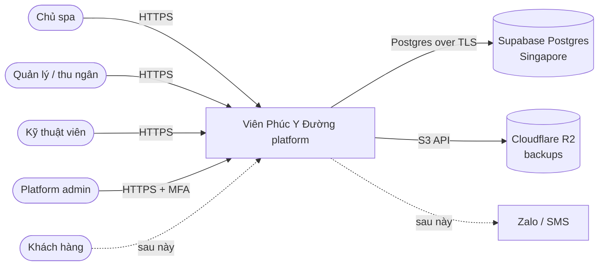
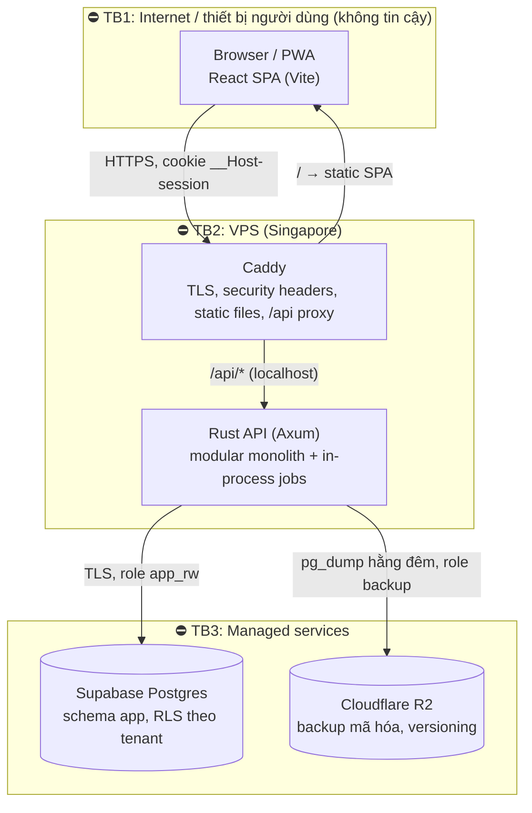

# Kiến trúc hệ thống (R1)

> ⚠️ Lỗi thời một phần về **hạ tầng** (ghi nhận 2026-11-09): sơ đồ §2–§3, bảng §6 và chi phí §7 là thiết kế gốc R1 (VPS Singapore + Caddy + backup R2). Staging hiện chạy **Vercel `pdx1` + Supabase `us-west-2`**, không có VPS, Caddy hay backup R2 nào đang chạy ([ADR-0005 update](../decisions/ADR-0005-compute-hosting.md), [vercel-staging](../runbooks/vercel-staging.md)); production dự kiến Singapore, chưa chốt nơi chạy API ([ADR-0012](../decisions/ADR-0012-colocate-api-db-singapore.md), Proposed). Code của đường VPS vẫn còn trong `infra/`. Bản tổng quan hiện hành: [docs/system-design.md](../../../docs/system-design.md). Các phần còn đúng: thứ tự ưu tiên chất lượng (§1), trust boundary (API là ranh giới tin cậy duy nhất, một origin), §4 (đã cập nhật theo `apps/api/crates` ngày 2026-11-09), §5 (đã cập nhật theo code), nguyên tắc ở §6.

## 1. Thứ tự ưu tiên chất lượng
Thứ tự này quyết định mọi đánh đổi bên dưới.
1. **Bảo mật & toàn vẹn dữ liệu.** Hệ thống giữ tiền, công nợ, số buổi đã trả và dữ liệu sức khỏe của khách. Sai ở đây là mất tiền và mất niềm tin.
2. **Dễ thay đổi.** Quy chế lương, quyền và gói dịch vụ sẽ đổi liên tục (xem [principles](principles.md)).
3. **Tốc độ thao tác ở quầy.** Mục tiêu < 30 giây một lượt khách.
4. **Chi phí thấp.**
5. **Sẵn sàng (availability)** trong giờ mở cửa. Khi hệ thống lỗi, spa vẫn có phương án giấy tạm.
6. **Khả năng mở rộng.** Tải rất thấp (khoảng 40 lượt/ngày/spa). Kiến trúc chỉ cần không chặn đường lên nhiều spa.

## 2. Context (C4 level 1)

## 3. Containers (C4 level 2) & trust boundaries

- **Một origin duy nhất** (ví dụ `app.<domain>`): Caddy trả SPA tĩnh và proxy `/api/*` vào Rust API (trên Vercel: rewrite `/api/*` sang service `api` trong `vercel.json`). Không có CORS; cookie `__Host-session` `SameSite=Strict` hoạt động tự nhiên.
- **Rust API là trust boundary duy nhất** cho authN, authZ, tenant isolation và tính toán tiền. SPA không giữ quyết định nào.
- **Không dùng Redis trong R1.** Session lưu ở Postgres. Rate limit in-memory theo IP, mỗi instance một bộ đếm (trên Vercel nhiều instance thì giới hạn thực tế lỏng hơn). Job chạy in-process (`app::jobs`); để nhiều instance không chạy trùng, mỗi job "claim" lượt chạy qua `app.claim_maintenance` (0035). Chưa có hàng đợi job (dự kiến bảng Postgres + `FOR UPDATE SKIP LOCKED` khi có nhắc nhở, spec #3).
- Đối chiếu mỗi boundary với các mối đe dọa: [security/threat-model](../security/threat-model.md).

## 4. Module (bounded context) trong Rust API
Xem [ADR-0006](../decisions/ADR-0006-repo-and-module-layout.md). Mỗi context là một crate riêng trong `apps/api/crates/`, chỉ export public API của nó (đồ thị phụ thuộc: [backend §5](backend.md)):
`kernel` (TenantId, Money, BusinessDate, lỗi, permission / `can()`, `TenantTx`, idempotency, mã hóa field, audit, registry tính năng) · `identity` (tài khoản, session, MFA, role/permission, tạo spa) · `org` (nhân viên, đợt làm việc, tài khoản của nhân viên) · `hr` (chấm công, đánh giá, thưởng/phạt, lương) · `catalog` · `crm` (khách, follow-up) · `packages` (CustomerPackage) · `sales` (Sale, Payment, Refund, nhập sổ giấy) · `operations` (Visit, lịch hẹn) · `reporting` (báo cáo, sổ doanh thu, lịch sử khách, nhật ký ghi chú; chỉ đọc) · `platform` (console admin nền tảng, [platform-admin](platform-admin.md)) · `app` (binary: router, config, middleware, job, CLI).
Chưa có: `ledger` (sổ quỹ, spec #2), `notifications` (nhắc nhở, spec #3).

## 5. Data flow các hành trình chính
**J1: Ghi lượt khách trừ buổi + dịch vụ lẻ (US4)**
1. SPA `GET /api/v1/customers?q=0905` → `crm` tìm theo SĐT chuẩn hóa / tên đã bỏ dấu (`customer.search_text` do app tính; `LIKE` trên khách của spa, không index trigram vì dưới RLS không dùng được, bỏ ở 0033) → danh sách khách; hồ sơ (`GET /customers/{id}`, `/customers/{id}/packages`) trả liệu trình. Ghi chú sức khỏe chỉ có trong response khi người gọi có permission.
2. SPA `POST /api/v1/visits` với `Idempotency-Key`. API thực hiện: cookie → `app.session_actor` (session + quyền + cài đặt spa trong một câu, ADR-0017) → `AuthUser` → `operations` kiểm `visit.record` → **một transaction** (`TenantTx`):
   - `set_config('app.tenant_id', …, true)` để RLS áp dụng;
   - claim `Idempotency-Key`;
   - `packages`: khóa gói `FOR SHARE`, rồi `UPDATE … SET sessions_remaining = sessions_remaining - qty, version = version + 1 WHERE … AND sessions_remaining >= qty` (0 dòng → `409`); trạng thái gói (hết hạn, đã hủy) là suy ra, kiểm trước đó;
   - `sales`: tạo Sale/Payment cho dịch vụ lẻ (và gói bán kèm, nếu có);
   - insert `visit` và `visit_line`;
   - ghi audit;
   - lưu kết quả idempotency (thứ tự ghi chính xác: [backend §3e](backend.md), `operations::service::checkout`).
   → commit → trả `VisitDto` (số buổi còn lại ở `sessions_left_after` từng dòng).
3. SPA (TanStack Query) invalidate cache khách và danh sách lượt hôm nay.

**J2: Bán liệu trình (US3):** `POST /api/v1/sales` (Idempotency-Key) → `sales` + `packages` trong một transaction: Sale, SaleLine, CustomerPackage (snapshot giá, per_session_value), Payment(s), audit.

**J3: Cuối ngày (spec #2, chưa làm):** `ledger` đọc Payment/Refund của ngày nghiệp vụ (Asia/Ho_Chi_Minh), cộng phiếu chi → chốt quỹ → khóa ngày. Hiện có sổ doanh thu chỉ đọc (`GET /reports/ledger`, view `app.revenue_book`); chưa có phiếu chi, chốt quỹ hay khóa ngày (ngày cũ được coi là "đã chốt" theo quy tắc `day.locked`).

**Cache:** không có cache phía server trong R1, vì Postgres đủ nhanh ở tải này. Client cache bảng giá và nhân viên qua TanStack Query.

## 6. Failure modes
| Thành phần hỏng / chậm | Ảnh hưởng | Cách xử lý |
|---|---|---|
| Supabase down | API trả `503`, quầy không ghi được | Banner "Hệ thống tạm gián đoạn"; quản lý ghi **phiếu tạm giấy**, nhập lại sau (giờ vào sửa được trong ngày). Theo dõi status Supabase, alert |
| VPS down | Không vào được app | Uptime check + alert; khởi động lại container tự động (`restart: unless-stopped`); runbook dựng lại VPS từ image + Docker Compose (< 1 giờ) |
| Mạng spa mất | Như trên, phía người dùng | Giả định luôn có mạng (EM); dùng 4G điện thoại làm dự phòng |
| R2 down | Backup đêm đó lỗi | Job retry, alert; backup Supabase vẫn còn |
| Deploy lỗi | Lỗi hàng loạt | Health check trước khi chuyển traffic; rollback về image trước |
| Request trùng / mạng chập chờn | Nguy cơ ghi đôi | Idempotency-Key cho mọi lệnh ghi (spec G4) |

## 7. Tải & chi phí năm 1
- 1 spa: khoảng 40 lượt/ngày, < 10 người dùng đồng thời, DB < 1 GB/năm. Ngay cả 50 spa cũng chỉ khoảng 2.000 lượt/ngày, vẫn trong sức một VPS nhỏ.
- Thành phần bão hòa đầu tiên (khi có rất nhiều spa): compute của Supabase (Micro). Nâng gói Supabase là đủ, không cần đổi kiến trúc.
- Chi phí: Supabase Pro (credits năm 1) + VPS khoảng $6–12/tháng + R2 khoảng $0 + domain. **Tổng khoảng $10–15/tháng** ngoài credits.

## 8. ADR liên quan
[ADR-0001 stack](../decisions/ADR-0001-tech-stack.md) · [ADR-0002 DB](../decisions/ADR-0002-database-hosting.md) · [ADR-0003 multi-tenancy](../decisions/ADR-0003-multi-tenancy.md) · [ADR-0004 auth](../decisions/ADR-0004-authentication.md) · [ADR-0005 compute hosting](../decisions/ADR-0005-compute-hosting.md) · [ADR-0006 repo & modules](../decisions/ADR-0006-repo-and-module-layout.md) · [ADR-0012 API + DB cùng Singapore](../decisions/ADR-0012-colocate-api-db-singapore.md) · [ADR-0017 xác thực một câu](../decisions/ADR-0017-one-statement-request-auth.md) · [ADR-0018 admin nền tảng](../decisions/ADR-0018-platform-admin-console.md)
