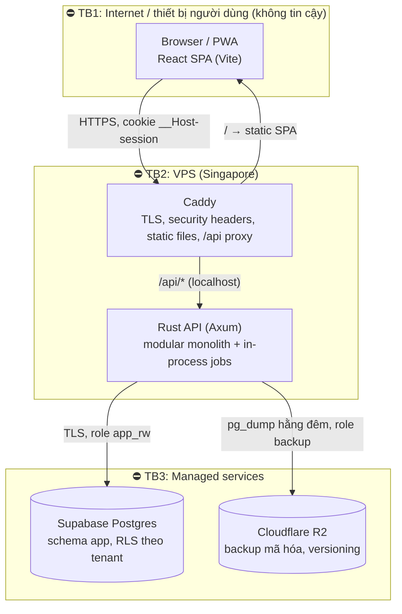

# Kiến trúc hệ thống (R1)

## 1. Thứ tự ưu tiên chất lượng
Thứ tự này quyết định mọi đánh đổi bên dưới.
1. **Bảo mật & toàn vẹn dữ liệu.** Hệ thống giữ tiền, công nợ, số buổi đã trả và dữ liệu sức khỏe của khách. Sai ở đây là mất tiền và mất niềm tin.
2. **Dễ thay đổi.** Quy chế lương, quyền và gói dịch vụ sẽ đổi liên tục (xem [principles](principles.md)).
3. **Tốc độ thao tác ở quầy.** Mục tiêu < 30 giây một lượt khách.
4. **Chi phí thấp.**
5. **Sẵn sàng (availability)** trong giờ mở cửa. Khi hệ thống lỗi, spa vẫn có phương án giấy tạm.
6. **Khả năng mở rộng.** Tải rất thấp (khoảng 40 lượt/ngày/spa). Kiến trúc chỉ cần không chặn đường lên nhiều spa.

## 2. Context (C4 level 1)

## 3. Containers (C4 level 2) & trust boundaries

- **Một origin duy nhất** (ví dụ `app.<domain>`): Caddy trả SPA tĩnh và proxy `/api/*` vào Rust API. Không có CORS; cookie `SameSite=Strict` hoạt động tự nhiên.
- **Rust API là trust boundary duy nhất** cho authN, authZ, tenant isolation và tính toán tiền. SPA không giữ quyết định nào.
- **Không dùng Redis trong R1.** Session lưu ở Postgres. Rate limit in-memory (một instance). Job chạy in-process, hàng đợi trong Postgres (`FOR UPDATE SKIP LOCKED`).
- Đối chiếu mỗi boundary với các mối đe dọa: [security/threat-model](../security/threat-model.md).

## 4. Module (bounded context) trong Rust API
Xem [ADR-0006](../decisions/ADR-0006-repo-and-module-layout.md). Mỗi context là một crate riêng, chỉ export public API của nó:
`kernel` (TenantId, Money, BusinessDate, lỗi, `can()`, audit) · `identity` (tài khoản, session, role/permission) · `org` (tenant, chi nhánh, nhân viên) · `catalog` · `crm` · `packages` (CustomerPackage) · `operations` (Visit) · `sales` (Sale, Payment, Refund, công nợ) · `ledger` (spec #2) · `notifications` (spec #3) · `app` (binary: router, config, wiring).

## 5. Data flow các hành trình chính
**J1: Ghi lượt khách trừ buổi + dịch vụ lẻ (US4)**
1. SPA `GET /api/v1/customers?q=0905` → `crm` tìm theo SĐT chuẩn hóa / tên đã bỏ dấu (index `pg_trgm` + `unaccent`) → trả về khách kèm tóm tắt liệu trình và công nợ. Ghi chú sức khỏe chỉ có trong response khi người gọi có permission.
2. SPA `POST /api/v1/visits` với `Idempotency-Key`. API thực hiện: session → `AuthUser` (tenant, permissions) → `operations` gọi `can(visit.record)` → **một transaction**:
   - `SET LOCAL app.tenant_id` để RLS áp dụng;
   - `packages`: `UPDATE … SET sessions_remaining = sessions_remaining - 1, version = version + 1 WHERE id = $1 AND tenant_id = $2 AND sessions_remaining >= 1 AND status = 'active'` (0 dòng → `409`);
   - insert `visit` và `visit_line`;
   - `sales`: tạo Sale/Payment cho dịch vụ lẻ;
   - ghi audit;
   - lưu kết quả idempotency.
   → commit → trả về số buổi còn lại.
3. SPA (TanStack Query) invalidate cache khách và danh sách lượt hôm nay.

**J2: Bán liệu trình (US3):** `POST /api/v1/sales` (Idempotency-Key) → `sales` + `packages` trong một transaction: Sale, SaleLine, CustomerPackage (snapshot giá, per_session_value), Payment(s), audit.

**J3: Cuối ngày (spec #2):** `ledger` đọc Payment/Refund của ngày nghiệp vụ (Asia/Ho_Chi_Minh), cộng phiếu chi → chốt quỹ → khóa ngày. Spec #2 sẽ chi tiết.

**Cache:** không có cache phía server trong R1, vì Postgres đủ nhanh ở tải này. Client cache bảng giá và nhân viên qua TanStack Query.

## 6. Failure modes
| Thành phần hỏng / chậm | Ảnh hưởng | Cách xử lý |
|---|---|---|
| Supabase down | API trả `503`, quầy không ghi được | Banner "Hệ thống tạm gián đoạn"; quản lý ghi **phiếu tạm giấy**, nhập lại sau (giờ vào sửa được trong ngày). Theo dõi status Supabase, alert |
| VPS down | Không vào được app | Uptime check + alert; khởi động lại container tự động (`restart: unless-stopped`); runbook dựng lại VPS từ image + Docker Compose (< 1 giờ) |
| Mạng spa mất | Như trên, phía người dùng | Giả định luôn có mạng (EM); dùng 4G điện thoại làm dự phòng |
| R2 down | Backup đêm đó lỗi | Job retry, alert; backup Supabase vẫn còn |
| Deploy lỗi | Lỗi hàng loạt | Health check trước khi chuyển traffic; rollback về image trước |
| Request trùng / mạng chập chờn | Nguy cơ ghi đôi | Idempotency-Key cho mọi lệnh ghi (spec G4) |

## 7. Tải & chi phí năm 1
- 1 spa: khoảng 40 lượt/ngày, < 10 người dùng đồng thời, DB < 1 GB/năm. Ngay cả 50 spa cũng chỉ khoảng 2.000 lượt/ngày, vẫn trong sức một VPS nhỏ.
- Thành phần bão hòa đầu tiên (khi có rất nhiều spa): compute của Supabase (Micro). Nâng gói Supabase là đủ, không cần đổi kiến trúc.
- Chi phí: Supabase Pro (credits năm 1) + VPS khoảng $6–12/tháng + R2 khoảng $0 + domain. **Tổng khoảng $10–15/tháng** ngoài credits.

## 8. ADR liên quan
[ADR-0001 stack](../decisions/ADR-0001-tech-stack.md) · [ADR-0002 DB](../decisions/ADR-0002-database-hosting.md) · [ADR-0003 multi-tenancy](../decisions/ADR-0003-multi-tenancy.md) · [ADR-0004 auth](../decisions/ADR-0004-authentication.md) · [ADR-0005 compute hosting](../decisions/ADR-0005-compute-hosting.md) · [ADR-0006 repo & modules](../decisions/ADR-0006-repo-and-module-layout.md)
